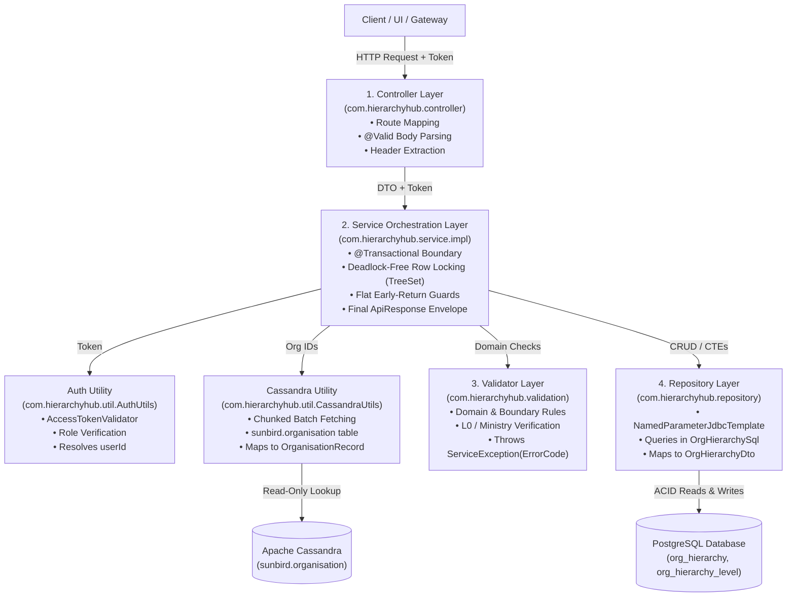

# Developer Guide: Coding Standards, Architectural Flow & API Implementation

**Service:** `cb-org-hierarchy-service`  
**Purpose:** Standardized developer playbook for creating, modifying, and refactoring APIs across all architectural layers.  
**Audience:** Backend Engineers, Code Reviewers, and Tech Leads.  

---

## 1. Architectural Blueprint & Layered Flow

`cb-org-hierarchy-service` follows a strict **Clean Layered Architecture** with distinct separation of concerns. Every request flows sequentially through the layers:



---

## 2. Layer-by-Layer Responsibilities & Code Style Rules

### 2.1. Controller Layer (`com.hierarchyhub.controller`)
* **Role**: The HTTP transport boundary.
* **Rules**:
  1. **Thin Controllers**: No business logic, no if-else branching, no SQL queries, no direct database calls.
  2. **Validation**: Use Jakarta Bean Validation (`@Valid` on `@RequestBody`).
  3. **Headers**: Always extract `x-authenticated-user-token` using `@RequestHeader(Constants.AUTH_TOKEN_HEADER) String accessToken`.
  4. **Return Type**: Always return `ResponseEntity<ApiResponse>` wrapping the service's returned `ApiResponse`.
* **Example Code Pattern**:
  ```java
  @PostMapping("/link")
  public ResponseEntity<ApiResponse> link(@Valid @RequestBody LinkOrgRequest request,
                                           @RequestHeader(Constants.AUTH_TOKEN_HEADER) String accessToken) {
      ApiResponse response = service.linkOrgToHierarchy(request, accessToken);
      return new ResponseEntity<>(response, response.getResponseCode());
  }
  ```

---

### 2.2. DTO & Event Contract Layer (`com.hierarchyhub.dto`)
* **Role**: Pure data carriers between client, controller, service, messaging, and data access layers.
* **Rules**:
  1. **Strictly Top-Level Files (NO Nested/Inner Static Classes)**:
     * **Never** nest static inner classes inside a request envelope (e.g., avoid `public static class Body` or `public static class LevelItem` inside `UpdateHierarchyLevelsRequest`).
     * Every DTO must be an independent, public, standalone `.java` file in `com.hierarchyhub.dto` and referenced via regular class imports.
     * **Why this matters**:
       * **Reusability**: Sub-structures and list items can be directly reused across multiple requests, responses, batch services, and repository mappers without awkward compound type names (e.g., `HierarchyLevelItem` can be reused directly in GET responses and repository batch updates).
       * **Clean Tooling & Serialization**: Avoids synthetic compiler artifacts (`Outer$Inner.class`) and ensures clean Jackson deserialization, Swagger/OpenAPI schema generation, and clean mock data fixtures in unit tests.
       * **Codebase Uniformity**: Follows the exact established project convention:
         * `LinkOrgRequest.java` $\rightarrow$ `LinkOrgRequestBody.java` $\rightarrow$ `AssociationRef.java`
         * `MoveOrgRequest.java` $\rightarrow$ `MoveOrgRequestBody.java`
         * `UnlinkOrgRequest.java` $\rightarrow$ `UnlinkOrgRequestBody.java`
         * `ReadChildrenRequest.java` $\rightarrow$ `ReadChildrenRequestBody.java`
  2. **Pure POJOs (Zero Business Logic & Zero Factory Helper Methods)**:
     * DTOs and event models (e.g., `HierarchyEvent`) must contain **strictly fields, constructors, getters, setters, and toString**.
     * **Never** add business logic, domain methods, or static event creation factory methods (such as `linkEvent()`, `moveEvent()`, `createX()`) inside DTO or Event classes.
     * All entity mapping, event creation, and field population logic belong strictly in the **Service or ServiceImpl layer**.
  3. **Envelope Pattern (2 Classes) vs. Flat POJO (1 Class)**:
     * **Pattern A: Standard Public Sunbird APIs (2 Standalone Classes)**: When an API must adhere to Sunbird's public request envelope `{ "request": { ... } }`, create two standalone top-level classes (`XRequest` outer wrapper holding `@Valid private XRequestBody request;` and `XRequestBody` holding the payload).
     * **Pattern B: Direct / Internal / Admin APIs (1 Standalone Class)**: When an API is driven by path variables (e.g., `/sync/{rootOrgId}`) or has flat/optional operational flags (e.g., `SyncParentPathRequest`), use a **single clean top-level POJO** without an unnecessary outer envelope class.
  4. **Lombok & Constructors**: Always use `@Getter`, `@Setter`, `@NoArgsConstructor`, `@AllArgsConstructor`.
  5. **JSON Serialization**: Use Jackson's `@JsonInclude(JsonInclude.Include.NON_NULL)` to omit empty fields where applicable.
  6. **Strict Jakarta Validation**: Always annotate fields with proper constraints (`@NotBlank`, `@NotNull`, `@NotEmpty`, `@Min`, `@Max`, `@Valid`). Always put `@Valid` on nested object and collection references.
* **Standard Pattern (3 Separate Top-Level Files)**:
  ```java
  // File 1: com/hierarchyhub/dto/UpdateHierarchyLevelsRequest.java
  @Getter
  @Setter
  @NoArgsConstructor
  @AllArgsConstructor
  public class UpdateHierarchyLevelsRequest {
      @NotNull(message = "request is required")
      @Valid
      private UpdateHierarchyLevelsRequestBody request;
  }

  // File 2: com/hierarchyhub/dto/UpdateHierarchyLevelsRequestBody.java
  @Getter
  @Setter
  @NoArgsConstructor
  @AllArgsConstructor
  public class UpdateHierarchyLevelsRequestBody {
      @NotEmpty(message = "levels list must not be empty")
      @Valid
      private List<HierarchyLevelItem> levels;
  }

  // File 3: com/hierarchyhub/dto/HierarchyLevelItem.java
  @Getter
  @Setter
  @NoArgsConstructor
  @AllArgsConstructor
  public class HierarchyLevelItem {
      @NotNull(message = "level is required")
      @Min(value = 1, message = "level must be between 1 and 10")
      @Max(value = 10, message = "level must be between 1 and 10")
      private Integer level;

      @NotBlank(message = "name is required")
      private String name;

      private String description;
  }
  ```

---

### 2.3. Service Layer (`com.hierarchyhub.service.impl`)
* **Role**: Core business orchestration and transaction boundary.
* **Rules**:
  1. **Transaction Manager**: Always bind explicitly to the PostgreSQL manager:
     ```java
     @Transactional(OrgHierarchyTransactionConfig.ORG_HIERARCHY_TX_MANAGER)
     ```
     *(Never use a bare `@Transactional` because the context also carries a legacy Neo4j transaction manager).*
  2. **Flat Early-Return Guard Pipelines**: Eliminate nested `if-else if-else` ladders. Each check evaluates its condition and returns or throws immediately:
     ```java
     if (childId.equals(parentId)) {
         failureErrors.add(new OrgLinkErrorDetail(childId, ErrorCode.CYCLE_DETECTED.name(), Constants.ERR_CANNOT_BE_OWN_PARENT));
         return;
     }
     ```
  3. **Deadlock Prevention (Sorted Locking)**: Whenever locking multiple rows (`SELECT ... FOR UPDATE`), **always sort IDs using `TreeSet<String>`** before calling `repository.lockRows(...)`. Concurrent transactions acquiring locks in identical order will queue safely instead of deadlocking.
  4. **Envelope Construction**: Services return the finished `ApiResponse` using:
     ```java
     return versionedResponse(Constants.API_LINK, new BatchOperationResponse(message));
     ```

---

### 2.4. Validator Layer (`com.hierarchyhub.validation.OrgHierarchyValidator`)
* **Role**: Encapsulates reusable domain rules and business invariants.
* **Rules**:
  1. **Pure Validation**: Methods inspect records and enforce rules; they throw `ServiceException(ErrorCode.<CODE>, "message")` directly on failure.
  2. **Do Not Query Directly**: Pass already-fetched records (e.g. `OrganisationRecord` from Cassandra or `OrgHierarchyDto` from PostgreSQL) into validator methods rather than having the validator query the database repeatedly.
* **Key Validator Methods Already Available for Reuse**:
  * `validateDistinctEntities(orgId, parentId)`: Throws `CYCLE_DETECTED` if `orgId.equals(parentId)`.
  * `requireActiveParentOrganisation(parentId, record)`: Checks parent is present and `status == 1`.
  * `requireMinistryOrStateRoot(parentId, record)`: Enforces `organizationType == 16 || 2048`.
  * `validateCyclePrevention(orgId, newParentId, ancestorChain)`: Ensures `ancestorChain` doesn't contain `orgId`.
  * `isMinistryOrStateRoot(record)`: Returns boolean check on `organizationType`.

---

### 2.5. Utilities Layer (`com.hierarchyhub.util`)

Never write ad-hoc Cassandra queries or JWT parsing logic in your service. Reusable utilities are already available:

#### A. `AuthUtils` (`com.hierarchyhub.util.AuthUtils`)
* Injects `AccessTokenValidator` and configured roles (`org-hierarchy.access.roles`).
* **For Write Operations (Role Protected)**:
  ```java
  // Verifies token signature + confirms user has STATE_ADMIN, SPV_ADMIN, or MDO_LEADER role
  String userId = authUtils.validateCallerAuthorizationAndFetchUserId(accessToken);
  ```
* **For Read Operations (Authentication Only)**:
  ```java
  // Verifies token signature and extracts userId without role restrictions
  String userId = authUtils.validateCallerAuthenticationAndFetchUserId(accessToken);
  ```

#### B. `CassandraUtils` (`com.hierarchyhub.util.CassandraUtils`)
* Injects `CassandraOperation` and auto-chunks batch queries according to `org-hierarchy.cassandra.fetch-chunk-size`.
* **Batch Fetching Organisations**:
  ```java
  Map<String, OrganisationRecord> records = cassandraUtils.fetchBatchOrganisationsFromTable(orgIds);
  ```
  * Automatically deduplicates IDs using `LinkedHashSet`.
  * Protects against Cassandra query size limits.
  * Maps raw properties map into immutable `OrganisationRecord(id, name, active, ministryId, orgType, ministryOrStateType)`.

#### C. `AppUtil` (`com.hierarchyhub.util.AppUtil`)
* **`AppUtil.isBlank(str)`**: Null/empty/whitespace check.
* **`AppUtil.defaultIfBlank(str, fallback)`**: Safe default fallback.
* **`AppUtil.encodeCursor(name, id)`** & **`decodeCursor(cursor)`**: Keyset pagination tokens.
* **`AppUtil.likeContainsPattern(query)`**: Escapes SQL `%`, `_`, and `\` for safe `LIKE` search.
* **`AppUtil.versionedResponse(apiId, result)`**: Auto-extracts URL version (`v2`) and builds standard envelope.

---

### 2.6. Repository & SQL Layer (`com.hierarchyhub.repository`)
* **Role**: Pure SQL data access using Spring's `NamedParameterJdbcTemplate`.
* **Rules**:
  1. **All SQL Kept in `OrgHierarchySql`**: Never write inline SQL strings inside Java methods. Keep static queries in `com.hierarchyhub.repository.OrgHierarchySql`.
  2. **Row Mappers**: Use static private `RowMapper` methods converting `ResultSet` into immutable DTO records (`OrgHierarchyDto`).
  3. **Batch Operations**: For inserting/updating multiple rows, always use batch JDBC methods (`batchUpdate`, `batchInsertMapped`).

---

### 2.7. External Microservice & HTTP Integration Standards (`com.hierarchyhub.client`)
* **Role**: Communicating with external microservices (e.g. Sunbird Organisation Service, Content Service).
* **Rules**:
  0. **Two Layers, Not One: Generic Transport vs. Domain-Specific Caller**:
     * **Generic layer: reuse `org.igot.common.service.OutboundRequestHandlerServiceImpl`, never write a project-local duplicate of it.** This bean already ships in the shared `common-util` library (`net.karmayogibharat:common-util`, the same jar that provides `CassandraOperation`/`AccessTokenValidator`) and is auto-registered by `org.igot.common.CommonAutoConfiguration` - it is already a singleton Spring bean the moment the dependency is on the classpath. It offers `fetchResult(uri)`, `fetchResultUsingPatch(uri, request, headers)`, `fetchResultUsingPost(uri, request, headers)`, `fetchUsingGetWithHeadersProfile(uri, headers)` (all returning `Map<String,Object>`/`Object`, headers as `Map<String,String>`). **Never re-declare a class literally named `OutboundRequestHandlerServiceImpl`** (or any other name Spring would default to the same bean name) anywhere in this project - two beans of that default name (ours vs. the auto-configured one from `common-util`) is a `BeanDefinitionStoreException` at startup ("Annotation-specified bean name ... conflicts with existing, non-compatible bean definition"), not a compile-time error, so it only surfaces when the app actually boots.
     * **Reading its response**: this shared client returns a parsed body `Map`, not an `HttpStatus` - it already swallows `HttpClientErrorException`/parses the error body into that same map shape. Treat a call as successful the same way this project's own `ApiResponse` envelope is read elsewhere in the codebase: check `"OK".equalsIgnoreCase(String.valueOf(response.get("responseCode")))` (via `Constants.RESPONSE_CODE_KEY`/`Constants.RESPONSE_CODE_OK`), not an HTTP status code you no longer have access to.
     * **Domain-specific layer** (e.g. `OrgUpdateServiceImpl`'s own `updateParentPathId` method): owns everything that *is* specific to one external API - resolving its own host+endpoint into a URL (via a shared properties class, e.g. `ExternalServiceProperties.getOrgServiceHost() + getOrgUpdateEndpoint()`, not scattered `@Value` fields read ad hoc - see rule 2 below), building its own auth headers, building its own request body (field names from `Constants`, never inline literals), and its own retry/backoff policy (`responseCode != "OK"` or an exception both count as a failed attempt). This logic does not need its own separate `*Client` class when it is only ever used by one service - fold it directly into that service as a private method, calling the shared `OutboundRequestHandlerServiceImpl` bean, rather than introducing an extra class purely to wrap one external call.
     * **Why**: this avoids writing (and then colliding with) a duplicate of infrastructure the shared library already provides, and avoids a separate one-call-only client class adding an indirection layer with no real reuse benefit.
  1. **One Shared Properties Class for Every External Service's Host/Endpoint/Credentials**: `com.hierarchyhub.config.ExternalServiceProperties` (`@Component @Getter`, every field a plain `@Value` with no inline default) holds the host/endpoint/auth-token/retry settings for every external microservice this app calls - a new integration (e.g. the content service) adds its own fields here (`contentServiceHost`, `contentHierarchyEndpoint`, ...), it does not get its own new properties class. Never read a `@Value` host/endpoint field directly inside a domain client/service - go through this shared properties bean.
  2. **Decoupled Host & Endpoint Pattern, Concatenated As-Configured (No Runtime Normalization)**:
     * **Never** hardcode URLs or hold host+endpoint as a single monolithic property.
     * **Never** embed default fallback URLs inside `@Value` (e.g., avoid `@Value("${service.url:http://localhost:8080/api/v1}")`).
     * Always split configuration into separate properties in `application.properties`:
       - `<service>-service-host=${...}` - **always configured with a trailing slash** (e.g. `org-service-host=http://localhost:8080/`).
       - `<service>-<action>-endpoint=<endpoint-path>` - **always configured without a leading slash** (e.g. `org-update-endpoint=api/org/v1/update`).
     * Given that convention, the call site concatenates the two directly - `externalServiceProperties.getOrgServiceHost() + externalServiceProperties.getOrgUpdateEndpoint()` - with **no runtime trailing-slash normalization/helper method**. The values from `application.properties` are trusted to already follow the convention above; do not add a defensive `getResolvedUrl()`-style join "just in case" a property is misconfigured - fix the property, don't code around it.
  3. **Resilience & Timeouts**:
     * Always configure connection timeouts, read timeouts, and bounded retry loops with backoff for downstream calls.

---

### 2.8. Configuration Properties & `@Value` Standards (Zero Hardcoded In-Code Values)
* **Role**: Managing application settings and environment variables.
* **Rules**:
  1. **Zero Inlined Fallback Defaults in `@Value`**:
     * **Never** write fallback defaults inside `@Value("${property.name:default_value}")` (e.g. avoid `@Value("${kafka.max.poll.interval.ms:15000}")`, `@Value("${org-update.max-attempts:3}")`).
     * Always write `@Value("${property.name}")` and define the property value cleanly in `src/main/resources/application.properties`.
  2. **Zero Hardcoded Magic Numbers in Configuration Classes**:
     * **Never** hardcode timeouts, thread counts, concurrency levels, batch sizes, acks, or retry limits directly in Spring/Kafka configuration classes (e.g., avoid `factory.getContainerProperties().setPollTimeout(3000)`, `factory.setConcurrency(4)`, `config.put(ProducerConfig.RETRIES_CONFIG, 3)`).
     * Always externalize all values to `application.properties`, map them through centralized properties components (e.g. `OrgHierarchyKafkaProperties`), and inject them dynamically into configuration beans.

---

### 2.9. Internal Computation Models (`com.hierarchyhub.model`)
* **Role**: Structures that carry state *inside* a service's own computation - never serialized, never crossing the API boundary (that is what `com.hierarchyhub.dto` is for).
* **Rules**:
  1. **No Private Static Inner Classes for Internal State Either**: The "no nested classes" rule in section 2.2 is not just a DTO rule - a service's own internal working types (an accumulator, a candidate/pending-work record, a paired result) must also be standalone top-level files in `com.hierarchyhub.model`, not `private static final class X { ... }` buried inside a `...ServiceImpl`. A nested class hides a reusable, independently testable shape behind one service's accident of implementation.
  2. **Prefer Java `record`s**: Most internal models are small immutable tuples (`OrgHierarchyDtoWithDepth(OrgHierarchyDto node, int depth)`, `PendingPathUpdate(String orgId, String parentPathId)`). Use a `record`, not a Lombok class, when every field is set once at construction and never mutated.
  3. **Mutable Accumulators Stay Immutable Too**: When a loop needs to accumulate counts/results across chunks or iterations (e.g. `SyncOutcome(int updated, int skipped, int failed)`), still model it as an immutable `record` with a `plus(...)`/combine method, and accumulate by reassigning a local variable (`outcome = outcome.plus(chunkOutcome)`), rather than a mutable class with setters passed around and mutated in place.

---

### 2.10. Service Interfaces That Also Serve Non-HTTP Callers (Kafka Consumers, Schedulers)
* **Role**: Some services are called both from a controller (needs auth + the versioned `ApiResponse` envelope) and from a non-HTTP caller such as a Kafka `@KafkaListener` or a scheduled job (has no access token, needs the raw domain result, not an envelope).
* **Rules**:
  1. **Keep the Controller Thin Even Here**: The controller rule in section 2.1 ("no business logic") includes auth-check orchestration and envelope-building - those are business/orchestration decisions, not transport concerns, so they belong in the service, exactly like every other API. Never call `authUtils.validateCallerAuthorizationAndFetchUserId(...)` or `AppUtil.versionedResponse(...)` from inside a controller method.
  2. **Expose Two Kinds of Methods on the Same Service Interface**:
     * A **domain method** (e.g. `SyncParentPathResponse project(String orgId)`) that takes no access token, does no auth check, and returns the raw domain result - for internal/system callers (a Kafka listener, a scheduled job) that have no caller identity to check and no HTTP envelope to build.
     * An **API method** (e.g. `ApiResponse repairSingleOrg(String orgId, String accessToken)`) that authorizes the caller, delegates to the domain method (or a shared private helper), and wraps the result as a versioned `ApiResponse` - for controller use.
  3. **Share One Private Core, Not Two Copies**: Both the domain method and the API method(s) should funnel into one private implementation method that does the actual computation (e.g. a private `syncParentPathForHierarchy(rootOrgId, request, userId)` called by both `project(orgId)` with the system-user and `syncHierarchy(...)` with the authorized caller's userId) - never duplicate the business logic once per caller type.

---

### 2.11. Bounded Executors & Bean-Name Constants
* **Role**: Dedicated thread pools (`ExecutorService`) backing concurrent dispatch (HTTP fan-out, background publishing) must be independently named Spring beans, injected by qualifier.
* **Rules**:
  1. **Bean-Name Strings Live in `Constants`, Not in the `@Configuration` Class**: A `@Bean(name)` string used elsewhere via `@Qualifier(name)` is a cross-class contract, not config-class-local detail - define it once as `Constants.PARENT_PATH_EXECUTOR` (etc.) and reference it from both the `@Configuration` class's `@Bean(...)` and every `@Qualifier(...)` injection site, rather than repeating (or worse, duplicating with a typo) the literal string, or defining a `public static final String` on the config class itself for other classes to import.
  2. **Pool Sizing Still Comes From `application.properties`** (per section 2.8) - only the bean's *name* is a fixed constant; its concurrency/queue-capacity/etc. are genuine environment config.

---

### 2.12. When a Config Value Is a Constant, Not a Property
* **Role**: Not everything read via `@Value` is genuinely an environment-specific setting.
* **Rule**: If a value is a fixed format/protocol detail that is **never going to differ between environments** (e.g. the `_` delimiter joining `parentPathId` ancestor segments) and is not expected to ever be reconfigured by an ops team, it belongs as a `public static final` in `Constants`, not as an `application.properties` entry read via `@Value`. Reserve `@Value`/`application.properties` for things that genuinely vary per deployment (hosts, endpoints, pool sizes, timeouts, feature flags, credentials). Getting this distinction right matters because every properties-file entry is something an operator could plausibly misconfigure; a value with only one correct answer shouldn't be exposed as if it had several.

---

## 3. Step-by-Step Guide: How to Create a New API

When building a new API (e.g., `PATCH /org/v2/hierarchy/levels/{rootOrgId}`), follow this exact 6-step checklist:

```
[Step 1: DTOs]       Define Request & Response POJOs with Jakarta validation in com.hierarchyhub.dto
      │
[Step 2: SQL]        Add static SQL statement constant to com.hierarchyhub.repository.OrgHierarchySql
      │
[Step 3: Repository] Add data access method in Repository (e.g. batchUpdateLevels)
      │
[Step 4: Validator]  Add any domain rule / guard method in OrgHierarchyValidator (if needed)
      │
[Step 5: Service]    Declare in OrgHierarchyService, implement in OrgHierarchyServiceImpl (@Transactional)
      │
[Step 6: Controller] Expose REST endpoint in OrgHierarchyController with @Valid and @RequestHeader
```

---

## 4. Complete End-to-End Walkthrough: Implementing the Levels Update API

Let us trace how the checklist is applied to create `PATCH /org/v2/hierarchy/levels/{rootOrgId}`:

### Step 1: DTO Definitions (3 Standalone Top-Level Classes in `com.hierarchyhub.dto`)

In accordance with project standards, each component of the request is an independent top-level class:

**1. Outer Request Envelope (`com.hierarchyhub.dto.UpdateHierarchyLevelsRequest`)**:
```java
package com.hierarchyhub.dto;

import jakarta.validation.Valid;
import jakarta.validation.constraints.NotNull;
import lombok.AllArgsConstructor;
import lombok.Getter;
import lombok.NoArgsConstructor;
import lombok.Setter;

@Getter
@Setter
@NoArgsConstructor
@AllArgsConstructor
public class UpdateHierarchyLevelsRequest {

    @NotNull(message = "request is required")
    @Valid
    private UpdateHierarchyLevelsRequestBody request;
}
```

**2. Request Body (`com.hierarchyhub.dto.UpdateHierarchyLevelsRequestBody`)**:
```java
package com.hierarchyhub.dto;

import jakarta.validation.Valid;
import jakarta.validation.constraints.NotEmpty;
import lombok.AllArgsConstructor;
import lombok.Getter;
import lombok.NoArgsConstructor;
import lombok.Setter;

import java.util.List;

@Getter
@Setter
@NoArgsConstructor
@AllArgsConstructor
public class UpdateHierarchyLevelsRequestBody {

    @NotEmpty(message = "levels list must not be empty")
    @Valid
    private List<HierarchyLevelItem> levels;
}
```

**3. Item Definition (`com.hierarchyhub.dto.HierarchyLevelItem`)**:
```java
package com.hierarchyhub.dto;

import jakarta.validation.constraints.Max;
import jakarta.validation.constraints.Min;
import jakarta.validation.constraints.NotBlank;
import jakarta.validation.constraints.NotNull;
import lombok.AllArgsConstructor;
import lombok.Getter;
import lombok.NoArgsConstructor;
import lombok.Setter;

@Getter
@Setter
@NoArgsConstructor
@AllArgsConstructor
public class HierarchyLevelItem {

    @NotNull(message = "level number is required")
    @Min(value = 1, message = "level must be between 1 and 10")
    @Max(value = 10, message = "level must be between 1 and 10")
    private Integer level;

    @NotBlank(message = "name is required")
    private String name;

    private String description;
}
```

### Step 2: SQL Statement (`com.hierarchyhub.repository.OrgHierarchySql`)
```java
static final String UPDATE_HIERARCHY_LEVEL =
    "UPDATE org_hierarchy_level " +
    "SET name = :name, description = :description, updated_by = :by, updated_at = now() " +
    "WHERE root_org_id = :rootOrgId AND level = :level";
```

### Step 3: Repository Implementation (`com.hierarchyhub.repository.OrgHierarchyLevelRepository`)
```java
public void batchUpdateLevels(String rootOrgId, List<HierarchyLevelItem> items, String userId) {
    MapSqlParameterSource[] batchParams = items.stream()
        .map(item -> new MapSqlParameterSource()
            .addValue("rootOrgId", rootOrgId)
            .addValue("level", item.getLevel())
            .addValue("name", item.getName())
            .addValue("description", item.getDescription())
            .addValue("by", userId))
        .toArray(MapSqlParameterSource[]::new);

    jdbc.batchUpdate(OrgHierarchySql.UPDATE_HIERARCHY_LEVEL, batchParams);
}
```

### Step 4: Service Orchestration (`com.hierarchyhub.service.impl.OrgHierarchyServiceImpl`)
```java
@Override
@Transactional(OrgHierarchyTransactionConfig.ORG_HIERARCHY_TX_MANAGER)
public ApiResponse updateHierarchyLevels(String rootOrgId, UpdateHierarchyLevelsRequest request, String accessToken) {
    // 1. Authorize caller and fetch userId
    String userId = authUtils.validateCallerAuthorizationAndFetchUserId(accessToken);

    // 2. Validate root organisation exists in hierarchy
    orgHierarchyValidator.requireExisting(
        orgHierarchyRepository.findById(rootOrgId).isPresent(),
        "Organisation " + rootOrgId + " is not in the hierarchy"
    );

    // 3. Ensure default levels exist before updating
    ensureDefaultLevelsProvisioned(rootOrgId, userId);

    // 4. Batch update in database using standalone DTO
    List<HierarchyLevelItem> items = request.getRequest().getLevels();
    orgHierarchyLevelRepository.batchUpdateLevels(rootOrgId, items, userId);
    log.info("updateHierarchyLevels: Updated {} levels for rootOrgId={} by userId={}", items.size(), rootOrgId, userId);

    // 5. Build standard versioned response
    return versionedResponse(Constants.API_LEVELS_UPDATE, 
        new BatchOperationResponse("Successfully updated hierarchy level definitions"));
}
```

### Step 5: Controller Endpoint (`com.hierarchyhub.controller.OrgHierarchyController`)
```java
@PatchMapping("/levels/{rootOrgId}")
public ResponseEntity<ApiResponse> updateLevels(
        @PathVariable("rootOrgId") String rootOrgId,
        @Valid @RequestBody UpdateHierarchyLevelsRequest request,
        @RequestHeader(Constants.AUTH_TOKEN_HEADER) String accessToken) {
    ApiResponse response = service.updateHierarchyLevels(rootOrgId, request, accessToken);
    return new ResponseEntity<>(response, response.getResponseCode());
}
```

---

## 5. Standard Error Handling & Response Envelopes

All errors in `cb-org-hierarchy-service` are centrally handled by `GlobalExceptionHandler`. 

* When a validation fails:
  ```java
  throw new ServiceException(ErrorCode.MINISTRY_MISMATCH, "Org belongs to ministry X but parent belongs to ministry Y");
  ```
* Spring automatically catches this and generates the standard Sunbird failure envelope:
  ```json
  {
    "id": "api.org.v2.hierarchy.levels.update",
    "ver": "v2",
    "ts": "2026-11-08 17:05:00.000",
    "params": {
      "resmsgid": "5a8e1b3d-2f94-4321-ba98-7c6d5e4f3a21",
      "msgid": "1d2e3f4a-5b6c-7d8e-9f0a-1b2c3d4e5f6a",
      "err": "MINISTRY_MISMATCH",
      "status": "FAILED",
      "errmsg": "Org belongs to ministry X but parent belongs to ministry Y"
    },
    "responseCode": "CONFLICT"
  }
  ```

---

## 6. Critical Golden Rules to Remember

1. **Strictly Standalone DTO Files (No Static Inner Classes)**: Every request envelope, request body, and list item must be an independent public `.java` file in `com.hierarchyhub.dto` and referenced via regular class imports. Never nest inner static classes.
2. **Never Put Business Logic or Factory Methods in DTOs / Events**: DTOs and Event objects hold strictly fields, constructors, getters, and setters. Never put event creation factory methods (like `linkEvent()`) in POJOs; construct events in the service layer.
3. **Zero Inlined Defaults in `@Value`**: Always write `@Value("${property.key}")` without fallback default values (`:15000`, `:3`). Define all configuration cleanly in `application.properties`.
4. **Decouple External Service Host and Endpoint**: Always configure `<service>-service-host` and `<service>-<action>-endpoint` as separate properties in `application.properties`. Never hardcode monolithic URLs.
5. **Zero Hardcoded Magic Numbers in Configuration**: All timeouts, concurrency numbers, acks, and retry limits in Kafka/Spring config classes must be externalized to properties and injected dynamically.
6. **Never Query Cassandra in a Loop**: Always use `cassandraUtils.fetchBatchOrganisationsFromTable(ids)` to read in chunks.
7. **Always Sort IDs Before Locking**: Use `TreeSet<String>` before `repository.lockRows(...)` to guarantee zero database deadlocks.
8. **Use Explicit Transaction Manager**: Always write `@Transactional(OrgHierarchyTransactionConfig.ORG_HIERARCHY_TX_MANAGER)`.
9. **No Code Without Test Coverage**: Accompany every new validator check with a unit test in `OrgHierarchyValidatorTest`.
10. **No Nested Classes for Internal State Either**: A service's own internal working types (accumulators, pending-work records) are standalone `record`s in `com.hierarchyhub.model`, never `private static final class` nested inside a `...ServiceImpl`.
11. **Auth + Envelope-Building Never Belong in the Controller, Even for Admin/Internal APIs**: A controller only ever calls one service method and wraps its `ApiResponse` in a `ResponseEntity`. If a service is also called from a Kafka listener or scheduler, give it both a raw domain method (no auth, no envelope) and an `ApiResponse`-returning method (auth + envelope) - both funneling into one shared private implementation.
12. **Bean-Name Strings for Qualified Executors Live in `Constants`**: Never repeat (or re-declare on the config class) a `@Bean(name)`/`@Qualifier(name)` string - define it once in `Constants`.
13. **A Fixed Format Detail Is a `Constants` Field, Not a Property**: Only values that genuinely vary per environment belong in `application.properties`/`@Value`; a value with exactly one correct answer (e.g. a path-join delimiter) is a `Constants` field.
14. **Outbound HTTP Calls Go Through the Shared `org.igot.common.service.OutboundRequestHandlerServiceImpl`, Never a Raw `RestTemplate` or a Project-Local Duplicate**: it is already an auto-configured bean from `common-util` - inject it directly. Never declare a project-local class with that same name (or any name Spring would default to the same bean name) - that is a startup-time `BeanDefinitionStoreException`, not a compile error. Read its `Map` response for success via `responseCode == "OK"`, not an HTTP status.
15. **Prefer `java.util.Objects`/Spring or JDK utility methods over a hand-written null-coalescing ternary**: `Objects.requireNonNullElseGet(value, Supplier)` (or `requireNonNullElse` for a plain default instance) instead of `value != null ? value : new Default()`.
16. **A Method/Field Name Should State the "What" and "Why", Not a Generic Verb**: `resyncParentPath(orgId)` not `project(orgId)`; `repairOrgParentPath(orgId, token)` not `repairSingleOrg(orgId, token)`; `syncSubtreeParentPaths(rootOrgId, request, token)` not `syncHierarchy(...)`. A reader should be able to tell what a method does from its name alone, without opening the method body or its javadoc.
