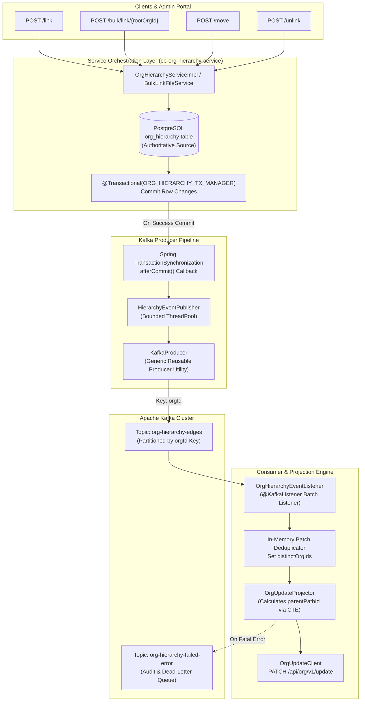

# Technical Specification: Apache Kafka Event Streaming for Org Hierarchy Changes

**Service:** `cb-org-hierarchy-service`  
**Purpose:** Event-Driven Messaging Architecture for Hierarchy Mutations (`/link`, `/bulk/link`, `/unlink`, `/move`)  
**Target Release / PR:** Kafka Event Sourcing & Downstream Hierarchy Synchronization  
**Document Status:** Complete Engineering Design Specification (Updated & Refined)  

---

## Table of Contents

1. [Executive Summary & Architectural Flow](#1-executive-summary--architectural-flow)
2. [Maven Dependencies & Spring Boot 3 Configuration](#2-maven-dependencies--spring-boot-3-configuration)
3. [Configuration Properties (`application.properties`)](#3-configuration-properties-applicationproperties)
4. [Centralized Kafka Properties Component (`KafkaProperties`)](#4-centralized-kafka-properties-component-kafkaproperties)
5. [Generic Kafka Producer Infrastructure](#5-generic-kafka-producer-infrastructure)
   - [5.1 Pure POJO Event Contract (`HierarchyEvent`)](#51-pure-pojo-event-contract-hierarchyevent)
   - [5.2 Producer Configuration (`ProducerConfiguration`)](#52-producer-configuration-producerconfiguration)
   - [5.3 Generic Reusable Producer Utility (`KafkaProducer`)](#53-generic-reusable-producer-utility-kafkaproducer)
   - [5.4 Hierarchy Event Publisher Service (`HierarchyEventPublisher`)](#54-hierarchy-event-publisher-service-hierarchyeventpublisher)
6. [Producer Integration into Hierarchy Mutation APIs](#6-producer-integration-into-hierarchy-mutation-apis)
   - [6.1 Transaction Safety: Post-Commit Event Publishing](#61-transaction-safety-post-commit-event-publishing)
   - [6.2 Service Event Creation Using `Constants` (Zero Hardcoding)](#62-service-event-creation-using-constants-zero-hardcoding)
   - [6.3 Single & Batch Link API (`POST /link`)](#63-single--batch-link-api-post-link)
   - [6.4 Bulk Link Excel Upload API (`POST /bulk/link/{rootOrgId}`)](#64-bulk-link-excel-upload-api-post-bulklinkrootorgid)
   - [6.5 Move API (`POST /move`)](#65-move-api-post-move)
   - [6.6 Unlink API (`POST /unlink`) (Leaf vs. Subtree)](#66-unlink-api-post-unlink-leaf-vs-subtree)
7. [Kafka Consumer Infrastructure](#7-kafka-consumer-infrastructure)
   - [7.1 Consumer Configuration (`ConsumerConfiguration`)](#71-consumer-configuration-consumerconfiguration)
   - [7.2 Hierarchy Event Consumer Listener (`OrgHierarchyEventListener`)](#72-hierarchy-event-consumer-listener-orghierarchyeventlistener)
   - [7.3 In-Memory Batch Deduplication Strategy](#73-in-memory-batch-deduplication-strategy)
   - [7.4 Failure Handling & Dead-Letter Audit Topic](#74-failure-handling--dead-letter-audit-topic)
8. [Failure Modes & Reliability Guarantees](#8-failure-modes--reliability-guarantees)
9. [Step-by-Step Implementation & Testing Checklist](#9-step-by-step-implementation--testing-checklist)

---

## 1. Executive Summary & Architectural Flow

The `cb-org-hierarchy-service` manages organisational hierarchies in **PostgreSQL** (`org_hierarchy` table) as the authoritative source of truth. Whenever an organisation is linked, bulk-linked, moved, or unlinked, external downstream systems (such as Cassandra `sunbird.organisation` and Elasticsearch `org_v4`) must be notified to synchronize breadcrumb paths (`parentPathId`), update cache entries, or refresh search indexes.

To keep primary HTTP transactions fast, decoupled, and resilient against external latency or network failures, we introduce **Apache Kafka event streaming**.

### 1.1 End-to-End Architectural Flow



### 1.2 Key Architectural Principles:
1. **Generic Reusable Infrastructure**: Generic classes (`KafkaProducer`, `ProducerConfiguration`, `ConsumerConfiguration`) are completely decoupled from domain logic so they can be reused for any topic or future feature across the service.
2. **Strict Partition Ordering (`Key = orgId`)**: Messages are keyed by `orgId`. Kafka guarantees that all events for the same organisation arrive sequentially on the same partition.
3. **Post-Commit Publishing**: Events are published **only after** the PostgreSQL transaction successfully commits. If the database rolls back, zero events are published.
4. **Pure POJO Contract**: The `HierarchyEvent` class contains **strictly fields, getters, setters, and constructors**. No factory helper methods exist inside the DTO; event assembly happens exclusively in the service layer using `Constants`.
5. **Zero Hardcoded Values & Direct Properties**: Direct properties in `application.properties` (no `${VAR:default}` syntax). In Java code, all `@Value` annotations read keys directly without fallback values.
6. **Real Organisation IDs in All Flows**: All examples use authoritative identifiers from `hierarchySampleFramework.json`.

---

## 2. Maven Dependencies & Spring Boot 3 Configuration

In `pom.xml`, add `spring-kafka` and test dependencies. Spring Boot 3.2.0 manages the underlying Apache Kafka client versions cleanly:

```xml
<dependencies>
    <!-- Apache Kafka Integration for Spring Boot 3 -->
    <dependency>
        <groupId>org.springframework.kafka</groupId>
        <artifactId>spring-kafka</artifactId>
    </dependency>

    <!-- Jackson for High-Performance JSON Serialization -->
    <dependency>
        <groupId>com.fasterxml.jackson.core</groupId>
        <artifactId>jackson-databind</artifactId>
    </dependency>
    <dependency>
        <groupId>com.fasterxml.jackson.core</groupId>
        <artifactId>jackson-core</artifactId>
    </dependency>

    <!-- Kafka Test Harness -->
    <dependency>
        <groupId>org.springframework.kafka</groupId>
        <artifactId>spring-kafka-test</artifactId>
        <scope>test</scope>
    </dependency>
</dependencies>
```

---

## 3. Configuration Properties (`application.properties`)

All settings are configured as direct values in `src/main/resources/application.properties`. **Notice: zero `${VAR:default}` syntax and zero in-code defaults**:

```properties
# ===================================================================
# Apache Kafka Server Configuration
# ===================================================================
spring.kafka.bootstrap.servers=localhost:9092

# ===================================================================
# Kafka Consumer Configuration Parameters
# ===================================================================
kafka.offset.reset.value=latest
kafka.max.poll.interval.ms=15000
kafka.max.poll.records=100
kafka.auto.commit.interval.ms=10000
kafka.consumer.concurrency=4
kafka.consumer.poll.timeout.ms=3000

# ===================================================================
# Kafka Producer Configuration Parameters
# ===================================================================
kafka.producer.acks=1
kafka.producer.retries=3
kafka.producer.max.in.flight.requests=5

# ===================================================================
# Org Hierarchy Kafka Topics & Consumer Groups
# ===================================================================
org.hierarchy.kafka.topic.edges=org-hierarchy-edges
org.hierarchy.kafka.consumer.group.id=org-hierarchy-parentpath-group
org.hierarchy.kafka.topic.failed.error=org-hierarchy-failed-error

# ===================================================================
# Publisher Thread Pool Settings & Retries
# ===================================================================
org.hierarchy.kafka.publisher.core-pool-size=2
org.hierarchy.kafka.publisher.max-pool-size=4
org.hierarchy.kafka.publisher.queue-capacity=1000
org.hierarchy.kafka.publisher.keep-alive-seconds=60
org.hierarchy.kafka.publisher.timeout-ms=3000
org.hierarchy.kafka.publisher.max-attempts=3
```

---

## 4. Centralized Kafka Properties Component (`KafkaProperties`)

All configuration is mapped into a single centralized component. Every `@Value` annotation references the property key directly without inline fallback defaults:

**File:** `src/main/java/com/hierarchyhub/config/KafkaProperties.java`

```java
package com.hierarchyhub.config;

import lombok.Getter;
import lombok.Setter;
import org.springframework.beans.factory.annotation.Value;
import org.springframework.stereotype.Component;

@Component
@Getter
@Setter
public class KafkaProperties {

    @Value("${spring.kafka.bootstrap.servers}")
    private String bootstrapServers;

    @Value("${org.hierarchy.kafka.topic.edges}")
    private String edgesTopic;

    @Value("${org.hierarchy.kafka.topic.failed.error}")
    private String failedErrorTopic;

    @Value("${org.hierarchy.kafka.consumer.group.id}")
    private String consumerGroupId;

    @Value("${kafka.offset.reset.value}")
    private String offsetResetValue;

    @Value("${kafka.max.poll.interval.ms}")
    private Integer maxPollIntervalMs;

    @Value("${kafka.max.poll.records}")
    private Integer maxPollRecords;

    @Value("${kafka.auto.commit.interval.ms}")
    private Integer autoCommitIntervalMs;

    @Value("${kafka.consumer.concurrency}")
    private Integer consumerConcurrency;

    @Value("${kafka.consumer.poll.timeout.ms}")
    private Long consumerPollTimeoutMs;

    @Value("${kafka.producer.acks}")
    private String producerAcks;

    @Value("${kafka.producer.retries}")
    private Integer producerRetries;

    @Value("${kafka.producer.max.in.flight.requests}")
    private Integer producerMaxInFlightRequests;

    @Value("${org.hierarchy.kafka.publisher.core-pool-size}")
    private Integer publisherCorePoolSize;

    @Value("${org.hierarchy.kafka.publisher.max-pool-size}")
    private Integer publisherMaxPoolSize;

    @Value("${org.hierarchy.kafka.publisher.queue-capacity}")
    private Integer publisherQueueCapacity;

    @Value("${org.hierarchy.kafka.publisher.keep-alive-seconds}")
    private Long publisherKeepAliveSeconds;

    @Value("${org.hierarchy.kafka.publisher.timeout-ms}")
    private Long publisherTimeoutMs;

    @Value("${org.hierarchy.kafka.publisher.max-attempts}")
    private Integer publisherMaxAttempts;
}
```

---

## 5. Generic Kafka Producer Infrastructure

### 5.1 Pure POJO Event Contract (`HierarchyEvent`)

Per the coding standards, `HierarchyEvent` is a **pure data carrier** with **only fields, constructors, getters, and setters**. It contains **zero business logic and zero helper methods**:

**File:** `src/main/java/com/hierarchyhub/dto/HierarchyEvent.java`

```java
package com.hierarchyhub.dto;

import com.fasterxml.jackson.annotation.JsonInclude;
import lombok.AllArgsConstructor;
import lombok.Getter;
import lombok.NoArgsConstructor;
import lombok.Setter;
import lombok.ToString;

@Getter
@Setter
@NoArgsConstructor
@AllArgsConstructor
@ToString
@JsonInclude(JsonInclude.Include.NON_NULL)
public class HierarchyEvent {

    /** Identifier of the organisation whose hierarchy edge changed. Partition Key. */
    private String orgId;

    /** New parent organisation ID (null if unlinked). */
    private String parentId;

    /** Previous parent organisation ID (populated during move and unlink; null for new link). */
    private String prevParentId;

    /** Display name of the organisation. */
    private String name;

    /** Whether the organisation is currently idle/unparented. */
    private Boolean idle;

    /** Operation type (e.g. Constants.EVENT_TYPE_LINK, Constants.EVENT_TYPE_MOVE). */
    private String eventType;

    /** Epoch timestamp in milliseconds. */
    private Long timestamp;

    /** Authenticated user who performed the action. */
    private String userId;
}
```

---

### 5.2 Producer Configuration (`ProducerConfiguration`)

Generic producer configuration. Injects parameters from `KafkaProperties`:

**File:** `src/main/java/com/hierarchyhub/config/ProducerConfiguration.java`

```java
package com.hierarchyhub.config;

import org.apache.kafka.clients.producer.ProducerConfig;
import org.apache.kafka.common.serialization.StringSerializer;
import org.springframework.context.annotation.Bean;
import org.springframework.context.annotation.Configuration;
import org.springframework.kafka.core.DefaultKafkaProducerFactory;
import org.springframework.kafka.core.KafkaTemplate;
import org.springframework.kafka.core.ProducerFactory;

import java.util.HashMap;
import java.util.Map;

@Configuration
public class ProducerConfiguration {

    private final KafkaProperties kafkaProperties;

    public ProducerConfiguration(KafkaProperties kafkaProperties) {
        this.kafkaProperties = kafkaProperties;
    }

    @Bean
    public ProducerFactory<String, String> producerFactory() {
        Map<String, Object> config = new HashMap<>();
        config.put(ProducerConfig.BOOTSTRAP_SERVERS_CONFIG, kafkaProperties.getBootstrapServers());
        config.put(ProducerConfig.KEY_SERIALIZER_CLASS_CONFIG, StringSerializer.class);
        config.put(ProducerConfig.VALUE_SERIALIZER_CLASS_CONFIG, StringSerializer.class);
        config.put(ProducerConfig.ACKS_CONFIG, kafkaProperties.getProducerAcks());
        config.put(ProducerConfig.RETRIES_CONFIG, kafkaProperties.getProducerRetries());
        config.put(ProducerConfig.MAX_IN_FLIGHT_REQUESTS_PER_CONNECTION, kafkaProperties.getProducerMaxInFlightRequests());
        return new DefaultKafkaProducerFactory<>(config);
    }

    @Bean
    public KafkaTemplate<String, String> kafkaTemplate() {
        return new KafkaTemplate<>(producerFactory());
    }
}
```

---

### 5.3 Generic Reusable Producer Utility (`KafkaProducer`)

A generic, application-wide producer service for serializing and pushing any object to any topic. Completely independent of hierarchy logic:

**File:** `src/main/java/com/hierarchyhub/producer/KafkaProducer.java`

```java
package com.hierarchyhub.producer;

import com.fasterxml.jackson.core.JsonProcessingException;
import com.fasterxml.jackson.databind.ObjectMapper;
import org.slf4j.Logger;
import org.slf4j.LoggerFactory;
import org.springframework.kafka.core.KafkaTemplate;
import org.springframework.stereotype.Service;

@Service
public class KafkaProducer {

    private static final Logger log = LoggerFactory.getLogger(KafkaProducer.class);
    private final KafkaTemplate<String, String> kafkaTemplate;
    private final ObjectMapper objectMapper = new ObjectMapper();

    public KafkaProducer(KafkaTemplate<String, String> kafkaTemplate) {
        this.kafkaTemplate = kafkaTemplate;
    }

    /**
     * Publishes a message to any Kafka topic without a partition key.
     */
    public void push(String topic, Object value) {
        try {
            String message = objectMapper.writeValueAsString(value);
            kafkaTemplate.send(topic, message);
        } catch (JsonProcessingException e) {
            log.error("Failed to serialize message for topic {}: {}", topic, e.getMessage(), e);
        }
    }

    /**
     * Publishes a message to any Kafka topic with a partition key.
     * Messages with the same key route to the same partition, guaranteeing strict FIFO order.
     */
    public void pushWithKey(String topic, Object value, String key) {
        try {
            String message = objectMapper.writeValueAsString(value);
            kafkaTemplate.send(topic, key, message);
        } catch (JsonProcessingException e) {
            log.error("Failed to serialize message with key {} for topic {}: {}", key, topic, e.getMessage(), e);
        }
    }
}
```

---

### 5.4 Hierarchy Event Publisher Service (`HierarchyEventPublisher`)

This service manages the background thread pool and uses `KafkaProducer` to publish hierarchy domain events:

**File:** `src/main/java/com/hierarchyhub/service/HierarchyEventPublisher.java`

```java
package com.hierarchyhub.service;

import com.hierarchyhub.config.KafkaProperties;
import com.hierarchyhub.dto.HierarchyEvent;
import com.hierarchyhub.producer.KafkaProducer;
import org.slf4j.Logger;
import org.slf4j.LoggerFactory;
import org.springframework.stereotype.Service;

import java.util.Collection;
import java.util.concurrent.ArrayBlockingQueue;
import java.util.concurrent.ExecutorService;
import java.util.concurrent.ThreadPoolExecutor;
import java.util.concurrent.TimeUnit;

@Service
public class HierarchyEventPublisher {

    private static final Logger log = LoggerFactory.getLogger(HierarchyEventPublisher.class);

    private final KafkaProducer kafkaProducer;
    private final KafkaProperties kafkaProperties;
    private final ExecutorService publishExecutor;

    public HierarchyEventPublisher(KafkaProducer kafkaProducer, KafkaProperties kafkaProperties) {
        this.kafkaProducer = kafkaProducer;
        this.kafkaProperties = kafkaProperties;
        this.publishExecutor = new ThreadPoolExecutor(
                kafkaProperties.getPublisherCorePoolSize(),
                kafkaProperties.getPublisherMaxPoolSize(),
                kafkaProperties.getPublisherKeepAliveSeconds(), TimeUnit.SECONDS,
                new ArrayBlockingQueue<>(kafkaProperties.getPublisherQueueCapacity()),
                new ThreadPoolExecutor.CallerRunsPolicy()
        );
    }

    /**
     * Publishes a single hierarchy event asynchronously using orgId as the partition key.
     */
    public void publishAsync(HierarchyEvent event) {
        if (event == null || event.getOrgId() == null) return;
        publishExecutor.execute(() -> {
            try {
                kafkaProducer.pushWithKey(kafkaProperties.getEdgesTopic(), event, event.getOrgId());
                log.info("Published hierarchy event: eventType={}, orgId={}, parentId={}, prevParentId={}",
                        event.getEventType(), event.getOrgId(), event.getParentId(), event.getPrevParentId());
            } catch (Exception e) {
                log.error("Failed to publish hierarchy event for orgId={}: {}", event.getOrgId(), e.getMessage(), e);
            }
        });
    }

    /**
     * Publishes a batch of events asynchronously.
     */
    public void publishBatchAsync(Collection<HierarchyEvent> events) {
        if (events == null || events.isEmpty()) return;
        publishExecutor.execute(() -> {
            for (HierarchyEvent event : events) {
                try {
                    kafkaProducer.pushWithKey(kafkaProperties.getEdgesTopic(), event, event.getOrgId());
                } catch (Exception e) {
                    log.error("Failed to publish batch event for orgId={}: {}", event.getOrgId(), e.getMessage(), e);
                }
            }
            log.info("Published batch of {} hierarchy events to topic {}", events.size(), kafkaProperties.getEdgesTopic());
        });
    }
}
```

---

## 6. Producer Integration into Hierarchy Mutation APIs

### 6.1 Transaction Safety: Post-Commit Event Publishing

> [!IMPORTANT]
> **Zero Phantom Events Rule**: Because mutations execute within `@Transactional(OrgHierarchyTransactionConfig.ORG_HIERARCHY_TX_MANAGER)`, events must be emitted **only after** PostgreSQL commits. If the transaction rolls back due to a constraint violation or exception, no Kafka event is published.

```java
// Helper in OrgHierarchyServiceImpl:
private void publishAfterCommit(Runnable publishTask) {
    if (TransactionSynchronizationManager.isActualTransactionActive()) {
        TransactionSynchronizationManager.registerSynchronization(new TransactionSynchronization() {
            @Override
            public void afterCommit() {
                publishTask.run();
            }
        });
    } else {
        publishTask.run();
    }
}
```

---

### 6.2 Service Event Creation Using `Constants` (Zero Hardcoding)

All event types, separators, and default values are called strictly from `Constants`:

```java
// Added to Constants.java:
public static final String EVENT_TYPE_LINK = "LINK";
public static final String EVENT_TYPE_BULK_LINK = "BULK_LINK";
public static final String EVENT_TYPE_MOVE = "MOVE";
public static final String EVENT_TYPE_UNLINK = "UNLINK";
public static final String SYSTEM_USER = "system";
public static final String PROJECTION_FAILED_PREFIX = "PROJECTION_FAILED: ";
```

Event assembly methods inside `OrgHierarchyServiceImpl.java`:

```java
private HierarchyEvent createLinkEvent(String childId, String parentId, String name, String userId) {
    HierarchyEvent event = new HierarchyEvent();
    event.setOrgId(childId);
    event.setParentId(parentId);
    event.setPrevParentId(null);
    event.setName(name);
    event.setIdle(false);
    event.setEventType(Constants.EVENT_TYPE_LINK);
    event.setTimestamp(System.currentTimeMillis());
    event.setUserId(userId);
    return event;
}

private HierarchyEvent createMoveEvent(String orgId, String newParentId, String oldParentId, String name, String userId) {
    HierarchyEvent event = new HierarchyEvent();
    event.setOrgId(orgId);
    event.setParentId(newParentId);
    event.setPrevParentId(oldParentId);
    event.setName(name);
    event.setIdle(false);
    event.setEventType(Constants.EVENT_TYPE_MOVE);
    event.setTimestamp(System.currentTimeMillis());
    event.setUserId(userId);
    return event;
}

private HierarchyEvent createUnlinkEvent(String orgId, String prevParentId, String name, String userId) {
    HierarchyEvent event = new HierarchyEvent();
    event.setOrgId(orgId);
    event.setParentId(null);
    event.setPrevParentId(prevParentId);
    event.setName(name);
    event.setIdle(true);
    event.setEventType(Constants.EVENT_TYPE_UNLINK);
    event.setTimestamp(System.currentTimeMillis());
    event.setUserId(userId);
    return event;
}
```

---

### 6.3 Single & Batch Link API (`POST /link`)

In `OrgHierarchyServiceImpl.linkChildrenUnderParentBatch`:

```java
persistBatchChildLinks(parentOrgId, userId, newChildIdsToInsert, newChildNamesToInsert, existingChildIdsToUpdate);

List<HierarchyEvent> eventsToPublish = new ArrayList<>();
for (String childId : succeededChildOrganisationIds) {
    String childName = childOrganisationRecords.containsKey(childId) ? 
            childOrganisationRecords.get(childId).name() : childId;
    eventsToPublish.add(createLinkEvent(childId, parentOrgId, childName, userId));
}

publishAfterCommit(() -> hierarchyEventPublisher.publishBatchAsync(eventsToPublish));
```

#### Real ID Trace from `hierarchySampleFramework.json`:
- Parent: `013715042930130944678` (Directorate of Bal Vikas and Pushtahar, L1)
- Child 1: `0146248595407994883407` (ICDS Gorakhpur, PIPRAICH)
- Child 2: `0146248567858708483395` (ICDS Jaunpur, Dharmapur)
- Published Events:
  - `key: "0146248595407994883407"`, `parentId: "013715042930130944678"`, `eventType: "LINK"`
  - `key: "0146248567858708483395"`, `parentId: "013715042930130944678"`, `eventType: "LINK"`

---

### 6.4 Bulk Link Excel Upload API (`POST /bulk/link/{rootOrgId}`)

In `BulkLinkFileService.java`, each chunk executes `orgHierarchyService.linkChildrenUnderParentBatch(...)`, which automatically triggers post-commit event publishing for all successful children in that chunk.

---

### 6.5 Move API (`POST /move`)

In `OrgHierarchyServiceImpl.moveOrgInHierarchy`:

```java
String oldParentId = lockedOrgHierarchyDto.parentId();
orgHierarchyRepository.setParent(orgId, newParentId, userId);
orgHierarchyRepository.decrementChildCount(oldParentId);
orgHierarchyRepository.incrementChildCount(newParentId);

HierarchyEvent event = createMoveEvent(orgId, newParentId, oldParentId, lockedOrgHierarchyDto.name(), userId);
publishAfterCommit(() -> hierarchyEventPublisher.publishAsync(event));
```

#### Real ID Trace from `hierarchySampleFramework.json`:
- Node moved: `014644373405949952127781` (ICDS Budaun)
- Old Parent: `013715042930130944678` (Directorate of Bal Vikas and Pushtahar)
- New Parent: `013700031472386048794` (Revenue Department Uttar Pradesh)
- Single Published Event:
  - `key: "014644373405949952127781"`, `parentId: "013700031472386048794"`, `prevParentId: "013715042930130944678"`, `eventType: "MOVE"`

---

### 6.6 Unlink API (`POST /unlink`) (Leaf vs. Subtree)

#### A. Single Leaf Unlink (`requireLeaf = true`):
```java
orgHierarchyRepository.unlinkRow(orgId, userId);
orgHierarchyRepository.decrementChildCount(lockedOrgHierarchyDto.parentId());

HierarchyEvent event = createUnlinkEvent(orgId, lockedOrgHierarchyDto.parentId(), lockedOrgHierarchyDto.name(), userId);
publishAfterCommit(() -> hierarchyEventPublisher.publishAsync(event));
```

#### B. Subtree Cascade Unlink (`requireLeaf = false`):
```java
orgHierarchyRepository.clearSubtree(descendantSubtreeOrgIds, userId);
orgHierarchyRepository.decrementChildCount(lockedOrgHierarchyDto.parentId());

List<HierarchyEvent> unlinkEvents = new ArrayList<>(descendantSubtreeOrgIds.size());
for (String detachedId : descendantSubtreeOrgIds) {
    unlinkEvents.add(createUnlinkEvent(detachedId, null, detachedId, userId));
}

publishAfterCommit(() -> hierarchyEventPublisher.publishBatchAsync(unlinkEvents));
```

---

## 7. Kafka Consumer Infrastructure

### 7.1 Consumer Configuration (`ConsumerConfiguration`)

Generic consumer container factory configuration. Injects parameters from `KafkaProperties`:

**File:** `src/main/java/com/hierarchyhub/config/ConsumerConfiguration.java`

```java
package com.hierarchyhub.config;

import org.apache.kafka.clients.consumer.ConsumerConfig;
import org.apache.kafka.common.serialization.StringDeserializer;
import org.springframework.context.annotation.Bean;
import org.springframework.context.annotation.Configuration;
import org.springframework.kafka.config.ConcurrentKafkaListenerContainerFactory;
import org.springframework.kafka.core.ConsumerFactory;
import org.springframework.kafka.core.DefaultKafkaConsumerFactory;

import java.util.HashMap;
import java.util.Map;

@Configuration
public class ConsumerConfiguration {

    private final KafkaProperties kafkaProperties;

    public ConsumerConfiguration(KafkaProperties kafkaProperties) {
        this.kafkaProperties = kafkaProperties;
    }

    @Bean
    public ConsumerFactory<String, String> consumerFactory() {
        Map<String, Object> props = new HashMap<>();
        props.put(ConsumerConfig.BOOTSTRAP_SERVERS_CONFIG, kafkaProperties.getBootstrapServers());
        props.put(ConsumerConfig.GROUP_ID_CONFIG, kafkaProperties.getConsumerGroupId());
        props.put(ConsumerConfig.ENABLE_AUTO_COMMIT_CONFIG, true);
        props.put(ConsumerConfig.AUTO_COMMIT_INTERVAL_MS_CONFIG, kafkaProperties.getAutoCommitIntervalMs());
        props.put(ConsumerConfig.AUTO_OFFSET_RESET_CONFIG, kafkaProperties.getOffsetResetValue());
        props.put(ConsumerConfig.KEY_DESERIALIZER_CLASS_CONFIG, StringDeserializer.class);
        props.put(ConsumerConfig.VALUE_DESERIALIZER_CLASS_CONFIG, StringDeserializer.class);
        props.put(ConsumerConfig.MAX_POLL_INTERVAL_MS_CONFIG, kafkaProperties.getMaxPollIntervalMs());
        props.put(ConsumerConfig.MAX_POLL_RECORDS_CONFIG, kafkaProperties.getMaxPollRecords());
        return new DefaultKafkaConsumerFactory<>(props);
    }

    @Bean
    public ConcurrentKafkaListenerContainerFactory<String, String> kafkaBatchListenerContainerFactory() {
        ConcurrentKafkaListenerContainerFactory<String, String> factory = new ConcurrentKafkaListenerContainerFactory<>();
        factory.setConsumerFactory(consumerFactory());
        factory.setBatchListener(true);
        factory.setConcurrency(kafkaProperties.getConsumerConcurrency());
        factory.getContainerProperties().setPollTimeout(kafkaProperties.getConsumerPollTimeoutMs());
        return factory;
    }
}
```

---

### 7.2 Hierarchy Event Consumer Listener (`OrgHierarchyEventListener`)

This domain listener specifically handles incoming hierarchy edge mutations and calls the projection service:

**File:** `src/main/java/com/hierarchyhub/consumer/OrgHierarchyEventListener.java`

```java
package com.hierarchyhub.consumer;

import com.fasterxml.jackson.databind.ObjectMapper;
import com.hierarchyhub.config.KafkaProperties;
import com.hierarchyhub.dto.Constants;
import com.hierarchyhub.dto.HierarchyEvent;
import com.hierarchyhub.producer.KafkaProducer;
import com.hierarchyhub.service.OrgUpdateProjector;
import org.apache.kafka.clients.consumer.ConsumerRecord;
import org.slf4j.Logger;
import org.slf4j.LoggerFactory;
import org.springframework.kafka.annotation.KafkaListener;
import org.springframework.stereotype.Component;

import java.util.LinkedHashSet;
import java.util.List;
import java.util.Set;

@Component
public class OrgHierarchyEventListener {

    private static final Logger log = LoggerFactory.getLogger(OrgHierarchyEventListener.class);

    private final OrgUpdateProjector orgUpdateProjector;
    private final KafkaProducer kafkaProducer;
    private final KafkaProperties kafkaProperties;
    private final ObjectMapper objectMapper = new ObjectMapper();

    public OrgHierarchyEventListener(OrgUpdateProjector orgUpdateProjector,
                                     KafkaProducer kafkaProducer,
                                     KafkaProperties kafkaProperties) {
        this.orgUpdateProjector = orgUpdateProjector;
        this.kafkaProducer = kafkaProducer;
        this.kafkaProperties = kafkaProperties;
    }

    @KafkaListener(
            topics = "${org.hierarchy.kafka.topic.edges}",
            groupId = "${org.hierarchy.kafka.consumer.group.id}",
            containerFactory = "kafkaBatchListenerContainerFactory"
    )
    public void onBatch(List<ConsumerRecord<String, String>> records) {
        if (records == null || records.isEmpty()) return;

        log.info("OrgHierarchyEventListener received batch of {} records", records.size());

        Set<String> distinctOrgIds = new LinkedHashSet<>();
        for (ConsumerRecord<String, String> record : records) {
            String key = record.key();
            if (key != null && !key.trim().isEmpty()) {
                distinctOrgIds.add(key.trim());
            } else {
                try {
                    HierarchyEvent event = objectMapper.readValue(record.value(), HierarchyEvent.class);
                    if (event.getOrgId() != null) {
                        distinctOrgIds.add(event.getOrgId());
                    }
                } catch (Exception e) {
                    log.warn("Could not parse event payload: {}", record.value(), e);
                }
            }
        }

        log.info("Deduplicated batch to {} unique orgIds: {}", distinctOrgIds.size(), distinctOrgIds);

        for (String orgId : distinctOrgIds) {
            try {
                orgUpdateProjector.project(orgId);
            } catch (Exception e) {
                log.error("Projection failed for orgId={}: {}", orgId, e.getMessage(), e);
                publishFailureAudit(orgId, e.getMessage());
            }
        }
    }

    private void publishFailureAudit(String orgId, String error) {
        try {
            HierarchyEvent failAudit = new HierarchyEvent();
            failAudit.setOrgId(orgId);
            failAudit.setEventType(Constants.PROJECTION_FAILED_PREFIX + error);
            failAudit.setTimestamp(System.currentTimeMillis());
            failAudit.setUserId(Constants.SYSTEM_USER);
            kafkaProducer.push(kafkaProperties.getFailedErrorTopic(), failAudit);
        } catch (Exception ignored) {}
    }
}
```

---

### 7.3 In-Memory Batch Deduplication Strategy

In high-throughput environments (e.g. bulk uploads), multiple operations might affect the same organisation in rapid succession. By collecting records into a `LinkedHashSet<String>`, we ensure:
- Only **one** projection run is executed per unique `orgId` per consumer poll.
- The projection engine always reads the **authoritative latest row state from PostgreSQL**.
- Order of first encounter is preserved.

---

### 7.4 Failure Handling & Dead-Letter Audit Topic

If an external sync call fails after exhaustive HTTP retries (e.g. downstream service down), the error is pushed to `org-hierarchy-failed-error`. This:
- Prevents consumer offset poisoning and infinite blocking.
- Allows operations teams to monitor and trigger manual targeted repair via `POST /org/v2/hierarchy/admin/parent-path/{orgId}`.

---

## 8. Failure Modes & Reliability Guarantees

| Failure Scenario | Consequence | Mitigation / Self-Healing |
| :--- | :--- | :--- |
| **PostgreSQL write fails** | Transaction rolls back. | Zero Kafka events emitted (guaranteed by `TransactionSynchronization.afterCommit`). |
| **Kafka Broker down during publish** | Event cannot be published immediately. | `publishExecutor` retries up to 3 times. Primary HTTP request still returns successfully. System can be repaired via `/admin/parent-path/{orgId}`. |
| **Consumer crashes mid-batch** | Uncommitted offset re-consumed on restart. | Idempotent: `project(orgId)` calculates current state from PostgreSQL. Re-running is a safe no-op. |
| **Out-of-order events for same org** | N/A (Guaranteed FIFO by partition key = `orgId`). | Even if received out-of-order, `project(orgId)` ignores historical payloads and always queries current DB state. |
| **Sunbird Org Update API returns 5xx** | Downstream update fails. | Retries with backoff; on fatal failure, emitted to `org-hierarchy-failed-error`. |

---

## 9. Step-by-Step Implementation & Testing Checklist

- [ ] **Step 1: Update `pom.xml`**
  - Add `spring-kafka` and `spring-kafka-test`.
- [ ] **Step 2: Update `application.properties`**
  - Add Kafka bootstrap servers, topics, consumer group ID, poll parameters, and pool settings with direct values (no `${VAR:default}`).
- [ ] **Step 3: Create Centralized Config**
  - Create `com.hierarchyhub.config.KafkaProperties` reading clean keys without inlined default fallbacks.
- [ ] **Step 4: Create Pure POJO Event Contract**
  - Create `com.hierarchyhub.dto.HierarchyEvent` with only fields, getters, setters, and constructors.
- [ ] **Step 5: Setup Producer Configuration & Classes**
  - Create `com.hierarchyhub.config.ProducerConfiguration`.
  - Create generic reusable `com.hierarchyhub.producer.KafkaProducer`.
  - Create `com.hierarchyhub.service.HierarchyEventPublisher`.
- [ ] **Step 6: Hook Events into `OrgHierarchyServiceImpl`**
  - Implement `publishAfterCommit` helper and private event assembly methods using `Constants`.
  - Wire event publishing into `linkChildrenUnderParentBatch`, `moveOrgInHierarchy`, and `unlinkOrgFromHierarchy`.
- [ ] **Step 7: Setup Consumer Configuration & Listener**
  - Create `com.hierarchyhub.config.ConsumerConfiguration`.
  - Create `com.hierarchyhub.consumer.OrgHierarchyEventListener`.
- [ ] **Step 8: Write Unit Tests**
  - Test `KafkaProducerTest` with mocked `KafkaTemplate`.
  - Test `HierarchyEventPublisherTest` verifying thread execution.
  - Test `OrgHierarchyEventListenerTest` verifying batch deduplication.
  - Verify that DB rollback emits zero Kafka events.
