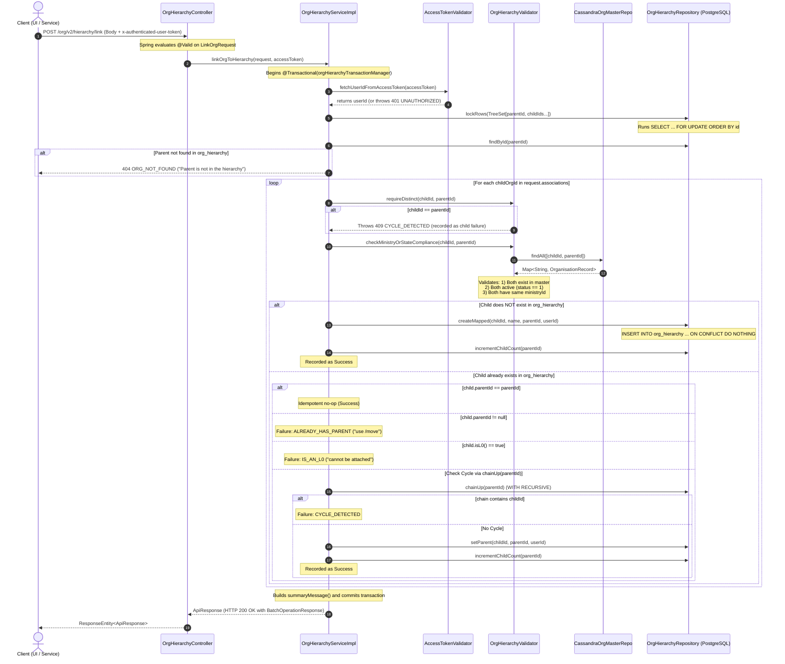

# Detailed Technical Flow & Architecture: `POST /org/v2/hierarchy/link`

This document provides a comprehensive end-to-end breakdown of the `/org/v2/hierarchy/link` endpoint in **`cb-org-hierarchy-service`**. It explains what the endpoint does, where data is read and stored, all participating classes, methods, code line numbers, validation rules, concurrency handling, and error scenarios.

---

## 1. Endpoint Overview

- **HTTP Method**: `POST`
- **Route**: `/org/v2/hierarchy/link`
- **Primary Responsibility**: Attaches one or more child organisations under a specified parent organisation in the hierarchy tree.
- **Batch Resiliency**: Operates as a resilient batch operation. If one child fails validation (e.g. cycle, already linked, inactive), that individual failure is recorded and returned in the summary message, but it **does not fail or halt the rest of the batch**.
- **Idempotency**: Linking a child that is already attached to the same parent succeeds as a no-op.
- **Dynamic Creation**: If a child does not exist yet in PostgreSQL `org_hierarchy`, it is dynamically created from its record in the Cassandra organisation master.

---

## 2. Architecture & Data Stores Involved

```
                                      +---------------------------------------------+
                                      |            Client / Gateway                 |
                                      +---------------------------------------------+
                                                             |
                                                             |  POST /org/v2/hierarchy/link
                                                             |  Header: x-authenticated-user-token
                                                             |  Body: LinkOrgRequest
                                                             v
+-----------------------------------------------------------------------------------------------------------------------+
| cb-org-hierarchy-service                                                                                              |
|                                                                                                                       |
|  1. OrgHierarchyController.link()                                                                                     |
|     - JSR-380 Bean Validation (@Valid)                                                                                |
|     - Header extraction                                                                                               |
|                                                                                                                       |
|  2. OrgHierarchyServiceImpl.linkOrgToHierarchy() [@Transactional(orgHierarchyTransactionManager)]                    |
|     - Step A: Verify JWT Auth Token -> Extract userId (via AccessTokenValidator)                                      |
|     - Step B: Sort IDs & acquire row locks: SELECT ... FOR UPDATE (PostgreSQL org_hierarchy)                          |
|     - Step C: Verify parentOrgId exists in org_hierarchy                                                              |
|     - Step D: Loop over each childOrgId:                                                                              |
|               * Validator: requireDistinct(childId, parentId)                                                         |
|               * Validator: checkMinistryOrStateCompliance() (Cassandra organisation master lookup)                    |
|               * Repo: If child is new -> INSERT INTO org_hierarchy & increment parent child_count                      |
|               * Repo: If child exists:                                                                                |
|                       - Check if already under parent (idempotent no-op)                                              |
|                       - Check if has another parent (reject -> ALREADY_HAS_PARENT)                                    |
|                       - Check if child is L0 (reject -> IS_AN_L0)                                                     |
|                       - Check cycle: WITH RECURSIVE chain (reject -> CYCLE_DETECTED)                                  |
|                       - UPDATE org_hierarchy SET parent_id = :parentId & increment parent child_count                |
|                                                                                                                       |
+-----------------------------------------------------------------------------------------------------------------------+
          |                                               |                                              |
          | Read SSO Public Key                           | Read Master Data (Read-Only)                 | Read, Lock & Write (ACID Tx)
          v                                               v                                              v
+---------------------------+             +----------------------------------+            +-----------------------------+
| Keycloak / SSO Public Key |             | Apache Cassandra                 |            | PostgreSQL                  |
| Filesystem                |             | Keyspace: sunbird                |            | Database: sunbird           |
| (public key verification) |             | Table: organisation              |            | Table: org_hierarchy        |
+---------------------------+             +----------------------------------+            +-----------------------------+
```

### Data Storage & Retrieval Details

| Data Store | Purpose | Access Mode | Tables / Keyspace | Fields Used |
| :--- | :--- | :--- | :--- | :--- |
| **PostgreSQL** | Source of truth for tree hierarchy & relationships | Read / Write / Lock (`FOR UPDATE`) | `org_hierarchy` | `id`, `name`, `parent_id`, `idle`, `child_count`, `created_at`, `created_by`, `updated_at`, `updated_by` |
| **Apache Cassandra** | Sunbird organisation master (authoritative registry) | Read-only | `sunbird.organisation` | `id`, `orgname`, `status`, `ministryorstateid` |
| **SSO / Keycloak Key Store** | Signature verification of user JWT tokens | Read-only | Filesystem (`accesstoken.publickey.basepath`) | Public key used by `AccessTokenValidator` |

---

## 3. End-to-End Execution Flow (With Code Line Numbers)



---

## 4. Class-by-Class & Line-by-Line Breakdown

### 4.1. Controller Layer

- **File**: [`OrgHierarchyController.java`](file:///home/adarshmalavade/Desktop/repo/cb-org-hierarchy-service/src/main/java/com/hierarchyhub/controller/OrgHierarchyController.java)
- **Annotations**:
  - Line 25: `@RestController`
  - Line 26: `@RequestMapping("/org/v2/hierarchy")`
- **Handler Method**:
  ```java
  // Lines 37-42
  @PostMapping("/link")
  public ResponseEntity<ApiResponse> link(@Valid @RequestBody LinkOrgRequest request,
                                           @RequestHeader(Constants.AUTH_TOKEN_HEADER) String accessToken) {
      ApiResponse response = service.linkOrgToHierarchy(request, accessToken);
      return new ResponseEntity<>(response, response.getResponseCode());
  }
  ```
  - **`@Valid`**: Triggers Spring / Hibernate Validator on `LinkOrgRequest`.
  - **`@RequestHeader(Constants.AUTH_TOKEN_HEADER)`**: Requires header `x-authenticated-user-token`. If absent, Spring throws `ServletRequestBindingException`, converted to `401 Unauthorized` by `GlobalExceptionHandler` (Lines 56–65).
  - **Return**: Wraps the `ApiResponse` returned by the service with its HTTP status (e.g. `200 OK`).

---

### 4.2. Request DTO & Bean Validations

- **File**: [`LinkOrgRequest.java`](file:///home/adarshmalavade/Desktop/repo/cb-org-hierarchy-service/src/main/java/com/hierarchyhub/dto/LinkOrgRequest.java)
  - Line 16: `@NotNull(message = "request is required")` on field `request`
  - Line 17: `@Valid` on field `request`
- **File**: [`LinkOrgRequest.java` (Inner Class `Body`)](file:///home/adarshmalavade/Desktop/repo/cb-org-hierarchy-service/src/main/java/com/hierarchyhub/dto/LinkOrgRequest.java#L35-L67)
  - Line 37: `@NotBlank(message = "parentOrgId is required")` on field `parentOrgId`
  - Line 40: `@NotEmpty(message = "associations must list at least one child")` on `List<AssociationRef> associations`
  - Line 41: `@Valid` on `associations`
- **File**: [`AssociationRef.java`](file:///home/adarshmalavade/Desktop/repo/cb-org-hierarchy-service/src/main/java/com/hierarchyhub/dto/AssociationRef.java)
  - Line 8: `@NotBlank(message = "childOrgId is required")` on field `childOrgId`

#### Validation Failure Handling:
- Handled by [`GlobalExceptionHandler.java`](file:///home/adarshmalavade/Desktop/repo/cb-org-hierarchy-service/src/main/java/com/hierarchyhub/config/GlobalExceptionHandler.java#L46-L54):
  - Catches `MethodArgumentNotValidException`.
  - Maps to HTTP `400 BAD_REQUEST`, `err: "INVALID_REQUEST"`, `errmsg: "request.parentOrgId: parentOrgId is required"`.

---

### 4.3. Service Implementation: `linkOrgToHierarchy`

- **File**: [`OrgHierarchyServiceImpl.java`](file:///home/adarshmalavade/Desktop/repo/cb-org-hierarchy-service/src/main/java/com/hierarchyhub/service/impl/OrgHierarchyServiceImpl.java)
- **Method**: `linkOrgToHierarchy(LinkOrgRequest request, String accessToken)` (Lines 68–87)

#### Step 1: User Authentication & ID Extraction
- **Line 70**: `String userId = fetchUserIdFromToken(accessToken);`
- **Lines 317–324 (`fetchUserIdFromToken`)**:
  - Invokes `accessTokenValidator.fetchUserIdFromAccessToken(accessToken)`.
  - If null, throws `ServiceException(ErrorCode.UNAUTHORIZED, "Invalid or expired access token")` (HTTP 401).

#### Step 2: Request Unpacking
- **Line 71**: `String parentId = request.getRequest().getParentOrgId();`
- **Line 72**: `List<String> childIds = identifiersOf(request.getRequest().getAssociations());`
- **Line 73**: `log.info("linkOrgToHierarchy request: parentId={}, childIds={}", parentId, childIds);`

#### Step 3: Deadlock-Free Row-Level Locking
- **Lines 75–77**:
  ```java
  TreeSet<String> rowsToLock = sorted(childIds);
  rowsToLock.add(parentId);
  repository.lockRows(rowsToLock);
  ```
- **Concurrency Protection**:
  - Using a `TreeSet` orders all IDs in natural sorted order.
  - Calling `lockRows(rowsToLock)` executes SQL:
    ```sql
    SELECT id, parent_id FROM org_hierarchy WHERE id IN (:ids) ORDER BY id FOR UPDATE
    ```
  - Because all concurrent transactions acquire row locks in the exact same sorted key order, **deadlocks are prevented**; conflicting transactions wait in queue instead of failing.

#### Step 4: Parent Hierarchy Existence Check
- **Line 78**:
  ```java
  requireExisting(parentId, "Parent " + parentId + " is not in the hierarchy: map it first (parents are mapped top-down)");
  ```
- **Lines 326–330 (`requireExisting`)**:
  - Queries `repository.findById(parentId)`.
  - If parent does not exist in `org_hierarchy`, throws `ServiceException(ErrorCode.ORG_NOT_FOUND, ...)` (HTTP 404).
  - Parents **must be mapped top-down**; you cannot attach a child to a parent that is not already in the tree.

#### Step 5: Batch Processing of Children
- **Lines 80–83**:
  ```java
  List<OrgOperationResult> results = new ArrayList<>();
  for (String childId : childIds) {
      results.add(attachChildUnderParent(parentId, childId, userId));
  }
  ```
- Each child is passed to `attachChildUnderParent`. Any rule violations for an individual child are caught and recorded as failures without breaking the remaining batch.

---

### 4.4. Child Attachment Logic: `attachChildUnderParent`

- **File**: [`OrgHierarchyServiceImpl.java`](file:///home/adarshmalavade/Desktop/repo/cb-org-hierarchy-service/src/main/java/com/hierarchyhub/service/impl/OrgHierarchyServiceImpl.java#L90-L130)

#### Rule 1: Self-Parenting Check (Distinctness)
- **Line 92**: `validator.requireDistinct(childId, parentId);`
- **Source**: [`OrgHierarchyValidator.java`](file:///home/adarshmalavade/Desktop/repo/cb-org-hierarchy-service/src/main/java/com/hierarchyhub/validation/OrgHierarchyValidator.java#L33-L37)
- **Validation**: `if (orgId.equals(parentId))`
- **Failure**: Throws `ServiceException(ErrorCode.CYCLE_DETECTED, "An org cannot be its own parent")` (HTTP 409).

#### Rule 2: Cassandra Master & Ministry / State Compliance
- **Line 93**: `Map<String, OrganisationRecord> masters = validator.checkMinistryOrStateCompliance(childId, parentId);`
- **Source**: [`OrgHierarchyValidator.java`](file:///home/adarshmalavade/Desktop/repo/cb-org-hierarchy-service/src/main/java/com/hierarchyhub/validation/OrgHierarchyValidator.java#L44-L63)
  1. Calls `master.findAll(Arrays.asList(childId, parentId))` on Cassandra.
  2. **Existence**: Both `childId` and `parentId` must be present in Cassandra `organisation` table. If not: throws `ServiceException(ErrorCode.ORG_NOT_FOUND, "Org <id> not found in the organisation master")`.
  3. **Active Status**: Both must have `active() == true` (where `status == 1`). If `status != 1`: throws `ServiceException(ErrorCode.ORG_INACTIVE, "Org <id> is inactive")`.
  4. **Ministry Check**:
     - Controlled by configuration `org-hierarchy.ministry.check-enabled` (default `true`).
     - Compares `child.ministryId()` and `parent.ministryId()` (Lines 65–82).
     - If either ministry is `null`:
       - Checked against `org-hierarchy.ministry.missing` policy: `ALLOW` passes; `BLOCK` throws `ServiceException(ErrorCode.MINISTRY_MISMATCH, "... has no ministry in the organisation master")`.
     - If both exist but `!Objects.equals(childMinistry, parentMinistry)`: throws `ServiceException(ErrorCode.MINISTRY_MISMATCH, "Org <childId> belongs to ministry <m1> but the parent <parentId> belongs to ministry <m2>")`.

#### Rule 3: Child Insertion vs Update in `org_hierarchy`
- **Line 95**: `Optional<OrgNode> existingChild = repository.findById(childId);`

##### Case A: Child is NOT yet in the hierarchy (`!existingChild.isPresent()`)
- **Lines 96–105**:
  - Resolves name: `masters.containsKey(childId) ? nameOrId(masters.get(childId)) : childId`.
  - Executes `repository.createMapped(childId, childName, parentId, userId)`:
    - **SQL**:
      ```sql
      INSERT INTO org_hierarchy (id, name, parent_id, idle, child_count, created_by, updated_by)
      VALUES (:id, :name, :parent, false, 0, :by, :by)
      ON CONFLICT (id) DO NOTHING RETURNING id
      ```
  - If inserted:
    - Increments parent child count: `repository.incrementChildCount(parentId)` (`child_count = child_count + 1`).
    - Returns `OrgOperationResult.success(childId, Constants.MSG_ORG_ADDED_TO_HIERARCHY)`.
  - If another thread created it first (`!created.isPresent()`), falls through to Case B.

##### Case B: Child ALREADY exists in the hierarchy
- **Lines 107–125**:
  - **Idempotency** (Lines 108–111):
    - `if (parentId.equals(child.parentId()))`: Already linked to this exact parent. Returns `OrgOperationResult.success(...)` immediately without any database update.
  - **Already Linked Elsewhere** (Lines 112–115):
    - `if (child.parentId() != null)`: The org is already linked under another parent.
    - Throws `ServiceException(ErrorCode.ALREADY_HAS_PARENT, "Org <childId> is already under <child.parentId()>; use /move")`.
  - **Is an L0 Root** (Lines 116–119):
    - `if (child.isL0())`: Root ministry or state (`parentId == null && !idle`).
    - Throws `ServiceException(ErrorCode.IS_AN_L0, "Org <childId> is a ministry or state: it cannot be attached under another org")`.
  - **Cycle Prevention** (Line 120):
    - `requireNoCycle(childId, parentId)` (Lines 342–347):
    - Calls `repository.chainUp(parentId)`:
      - **SQL**: Recursive CTE traversing parent pointers up to root (max depth 50):
        ```sql
        WITH RECURSIVE chain(id, parent_id, depth) AS (
          SELECT id, parent_id, 1 FROM org_hierarchy WHERE id = :id
          UNION ALL
          SELECT o.id, o.parent_id, c.depth + 1 FROM org_hierarchy o JOIN chain c ON o.id = c.parent_id
          WHERE c.depth < :maxDepth
        ) SELECT id FROM chain
        ```
    - If `chain.contains(childId)`: attaching `childId` under `parentId` would create a circular loop!
    - Throws `ServiceException(ErrorCode.CYCLE_DETECTED, "Org <childId> cannot be placed under <parentId>: that is one of its own descendants")`.
  - **Update Parent** (Lines 122–125):
    - `repository.setParent(childId, parentId, userId)`:
      - **SQL**:
        ```sql
        UPDATE org_hierarchy SET parent_id = :parent, idle = false, updated_by = :by, updated_at = now() WHERE id = :id
        ```
    - `repository.incrementChildCount(parentId)`:
      - **SQL**:
        ```sql
        UPDATE org_hierarchy SET child_count = child_count + 1 WHERE id = :id
        ```
    - Returns `OrgOperationResult.success(childId, Constants.MSG_ORG_ADDED_TO_HIERARCHY)`.

---

### 4.5. Summary Message & Response Construction

- **Lines 84–86**:
  ```java
  String message = summaryMessage("added", "to", Constants.MSG_ORG_ADDED_TO_HIERARCHY, results);
  logOutcome("linkOrgToHierarchy", parentId, results);
  return versionedResponse(Constants.API_LINK, new BatchOperationResponse(message));
  ```
- **`summaryMessage` (Lines 367–381)**:
  - If all children succeeded:
    - `"Successfully added organisation to the hierarchy"`
  - If any child failed:
    - Appends failure details:
      `"Successfully added organisation to the hierarchy; Failed to add organisation to the hierarchy for orgId: 01357... (reason)"`
- **`versionedResponse` (Lines 433–435 & `AppUtil.java#L56-L63`)**:
  - Builds `ApiResponse` envelope:
    - `id`: `"api.org.hierarchy.link"`
    - `ver`: `"v2"` (automatically resolved from the request URI `/org/v2/hierarchy/link`)
    - `params`: status `"SUCCESS"`, unique UUIDs for `resmsgid` and `msgid`
    - `responseCode`: `200 OK`
    - `result`: `{ "message": "..." }`

---

## 5. Summary of All Validations Checked

| # | Validation Category | Checked Field / Condition | Implemented In | Error Code | HTTP Status |
| :- | :--- | :--- | :--- | :--- | :- |
| 1 | **Request Body** | `request` is not null | `LinkOrgRequest.java:16` | `INVALID_REQUEST` | 400 Bad Request |
| 2 | **Request Body** | `request.parentOrgId` is not blank | `LinkOrgRequest.java:37` | `INVALID_REQUEST` | 400 Bad Request |
| 3 | **Request Body** | `request.associations` is not empty | `LinkOrgRequest.java:40` | `INVALID_REQUEST` | 400 Bad Request |
| 4 | **Request Body** | `associations[].childOrgId` is not blank | `AssociationRef.java:8` | `INVALID_REQUEST` | 400 Bad Request |
| 5 | **Authentication** | `x-authenticated-user-token` header present | `OrgHierarchyController.java:39` | `UNAUTHORIZED` | 401 Unauthorized |
| 6 | **Token Validation** | Token signature valid and not expired | `OrgHierarchyServiceImpl.java:318` | `UNAUTHORIZED` | 401 Unauthorized |
| 7 | **Parent Existence** | `parentOrgId` exists in PostgreSQL `org_hierarchy` | `OrgHierarchyServiceImpl.java:78` | `ORG_NOT_FOUND` | 404 Not Found |
| 8 | **Distinctness** | `childOrgId != parentOrgId` | `OrgHierarchyValidator.java:34` | `CYCLE_DETECTED` | 409 Conflict |
| 9 | **Master Existence** | Both orgs exist in Cassandra `organisation` | `OrgHierarchyValidator.java:51` | `ORG_NOT_FOUND` | 404 Not Found |
| 10 | **Active Status** | Both orgs have `status == 1` in Cassandra | `OrgHierarchyValidator.java:55` | `ORG_INACTIVE` | 400 Bad Request |
| 11 | **Ministry Match** | Both orgs share `ministryorstateid` in Cassandra | `OrgHierarchyValidator.java:65` | `MINISTRY_MISMATCH` | 409 Conflict |
| 12 | **Existing Parent** | Child does not already have a different `parent_id` | `OrgHierarchyServiceImpl.java:112`| `ALREADY_HAS_PARENT`| 409 Conflict |
| 13 | **L0 Immutability** | Child is not an L0 (`parentId == null && !idle`) | `OrgHierarchyServiceImpl.java:116`| `IS_AN_L0` | 409 Conflict |
| 14 | **Cycle Prevention** | `parentId` ancestors chain does not contain `childId` | `OrgHierarchyServiceImpl.java:343`| `CYCLE_DETECTED` | 409 Conflict |

---

## 6. Sample Request & Response Payloads

### 6.1. Successful Request

**Headers**:
```http
POST /org/v2/hierarchy/link HTTP/1.1
Host: localhost:8888
Content-Type: application/json
x-authenticated-user-token: eyJhbGciOiJSUzI1NiIsInR5cCI6IkpXVCJ9...
```

**Request Body**:
```json
{
  "request": {
    "parentOrgId": "0142691971194388486",
    "associations": [
      { "childOrgId": "01357983854455193614" },
      { "childOrgId": "01357983854455193615" }
    ]
  }
}
```

**Success Response (HTTP 200 OK)**:
```json
{
  "id": "api.org.hierarchy.link",
  "ver": "v2",
  "ts": "2026-11-05 15:20:00.000",
  "params": {
    "resmsgid": "7f80db7b-1234-4567-89ab-cdef01234567",
    "msgid": "a901ef23-4567-89ab-cdef-0123456789ab",
    "err": null,
    "status": "SUCCESS",
    "errmsg": null
  },
  "responseCode": "OK",
  "result": {
    "message": "Successfully added organisation to the hierarchy"
  }
}
```

### 6.2. Partial Failure in Batch (HTTP 200 OK with Failure Reason)

When one child succeeds and another fails (e.g. child already has another parent):
```json
{
  "id": "api.org.hierarchy.link",
  "ver": "v2",
  "ts": "2026-11-05 15:20:00.000",
  "params": {
    "resmsgid": "7f80db7b-1234-4567-89ab-cdef01234567",
    "msgid": "a901ef23-4567-89ab-cdef-0123456789ab",
    "err": null,
    "status": "SUCCESS",
    "errmsg": null
  },
  "responseCode": "OK",
  "result": {
    "message": "Successfully added organisation to the hierarchy; Failed to add organisation to the hierarchy for orgId: 01357983854455193615 (Org 01357983854455193615 is already under 0142999999999999999; use /move)"
  }
}
```

### 6.3. Bean Validation Failure (HTTP 400 Bad Request)

If `parentOrgId` is blank:
```json
{
  "id": "api.org.v2.hierarchy.link",
  "ver": "v2",
  "ts": "2026-11-05 15:20:00.000",
  "params": {
    "resmsgid": "3b2c1a09-8765-4321-fedc-ba9876543210",
    "msgid": "dcba9876-5432-10fe-dcba-9876543210fe",
    "err": "INVALID_REQUEST",
    "status": "FAILED",
    "errmsg": "request.parentOrgId: parentOrgId is required"
  },
  "responseCode": "BAD_REQUEST"
}
```

### 6.4. Missing Authentication Token (HTTP 401 Unauthorized)

If header `x-authenticated-user-token` is missing:
```json
{
  "id": "api.org.v2.hierarchy.link",
  "ver": "v2",
  "ts": "2026-11-05 15:20:00.000",
  "params": {
    "resmsgid": "5f6e7d8c-9a0b-1c2d-3e4f-5a6b7c8d9e0f",
    "msgid": "1a2b3c4d-5e6f-7a8b-9c0d-1e2f3a4b5c6d",
    "err": "UNAUTHORIZED",
    "status": "FAILED",
    "errmsg": "An access token (x-authenticated-user-token header) is required for this API"
  },
  "responseCode": "UNAUTHORIZED"
}
```

