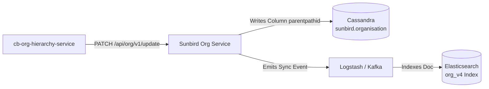

# Technical Specification: `parentPathId` Calculation, External Org Update API & Hierarchy Sync Engine

**Service:** `cb-org-hierarchy-service`  
**Purpose:** End-to-End Implementation Blueprint for `parentPathId` Calculation, External Sunbird Org Update API (`PATCH /api/org/v1/update`), Kafka Consumer Sync, and Deep Hierarchy Repair APIs.  
**Target Release / PR:** Downstream Cassandra & Elasticsearch Synchronization  
**Document Status:** Complete Engineering Design Specification (Updated & Refined)  

---

## Table of Contents

1. [Executive Summary & Background Context](#1-executive-summary--background-context)
2. [What is `parentPathId`? (Rules, Hierarchy Levels & Real ID Formulas)](#2-what-is-parentpathid-rules-hierarchy-levels--real-id-formulas)
   - [2.1 Structure & Delimiter Rule](#21-structure--delimiter-rule)
   - [2.2 Trace Matrix Across Hierarchy Levels (Real `orgId`s from Framework)](#22-trace-matrix-across-hierarchy-levels-real-orgids-from-framework)
   - [2.3 Impact of Hierarchy Mutations (Link, Bulk Link, Move, Unlink)](#23-impact-of-hierarchy-mutations-link-bulk-link-move-unlink)
3. [The External Sunbird Org Update API Contract](#3-the-external-sunbird-org-update-api-contract)
   - [3.1 Host & Endpoint Configuration (From `application.properties`)](#31-host--endpoint-configuration-from-applicationproperties)
   - [3.2 Outbound Request & Upstream Response Payloads](#32-outbound-request--upstream-response-payloads)
   - [3.3 Downstream Propagation into Cassandra & Elasticsearch](#33-downstream-propagation-into-cassandra--elasticsearch)
4. [Proposed APIs & DTO Simplification](#4-proposed-apis--dto-simplification)
   - [4.1 API Architecture Evaluation (How Many APIs & Why)](#41-api-architecture-evaluation-how-many-apis--why)
   - [4.2 DTO Simplification: Single Top-Level POJO](#42-dto-simplification-single-top-level-pojo)
   - [4.3 API 1: Targeted Single-Org / Kafka Worker API (`POST /admin/parent-path/{orgId}`)](#43-api-1-targeted-single-org--kafka-worker-api-post-adminparent-pathorgid)
   - [4.4 API 2: Deep Subtree / Root Hierarchy Sync API (`POST /admin/parent-path/sync/{rootOrgId}`)](#44-api-2-deep-subtree--root-hierarchy-sync-api-post-adminparent-pathsyncrootorgid)
   - [4.5 API 3 (Recommended Admin Utility): Full System Rebuild (`POST /admin/parent-path/rebuild`)](#45-api-3-recommended-admin-utility-full-system-rebuild-post-adminparent-pathrebuild)
5. [Configuration Properties (`application.properties`)](#5-configuration-properties-applicationproperties)
6. [Core Algorithms & PostgreSQL Recursive CTE Queries](#6-core-algorithms--postgresql-recursive-cte-queries)
   - [6.1 CTE 1: Ancestor Upward Chain (`CHAIN_UP_WITH_PARENTS`)](#61-cte-1-ancestor-upward-chain-chain_up_with_parents)
   - [6.2 CTE 2: Subtree Descendants With Materialized Path Arrays (`SUBTREE_WITH_PATHS`)](#62-cte-2-subtree-descendants-with-materialized-path-arrays-subtree_with_paths)
   - [6.3 Path Computation Utility: `ParentPaths.java`](#63-path-computation-utility-parentpathsjava)
7. [High-Scale Performance Optimizations](#7-high-scale-performance-optimizations)
   - [7.1 Leaf-Node Fast Path (Zero Children Handling)](#71-leaf-node-fast-path-zero-children-handling)
   - [7.2 Diff-Checking: Avoid Redundant External HTTP Calls](#72-diff-checking-avoid-redundant-external-http-calls)
   - [7.3 Batching & Bounded Concurrency Thread Pool](#73-batching--bounded-concurrency-thread-pool)
8. [External HTTP Client Implementation (`OrgUpdateClient`)](#8-external-http-client-implementation-orgupdateclient)
   - [8.1 Externalized Properties & Clean URL Resolution](#81-externalized-properties--clean-url-resolution)
   - [8.2 Resilient Retry Loop with Configurable Backoff](#82-resilient-retry-loop-with-configurable-backoff)
9. [Layer-by-Layer Code Implementation Guide (Per Coding Standards)](#9-layer-by-layer-code-implementation-guide-per-coding-standards)
   - [9.1 DTO Layer (`com.hierarchyhub.dto`) - Single Top-Level POJO](#91-dto-layer-comhierarchyhubdto---single-top-level-pojo)
   - [9.2 SQL Layer (`com.hierarchyhub.repository.OrgHierarchySql`)](#92-sql-layer-comhierarchyhubrepositoryorghierarchysql)
   - [9.3 Repository Layer (`com.hierarchyhub.repository.OrgHierarchyRepository`)](#93-repository-layer-comhierarchyhubrepositoryorghierarchyrepository)
   - [9.4 Service Layer (`com.hierarchyhub.service.OrgUpdateProjector`)](#94-service-layer-comhierarchyhubserviceorgupdateprojector)
   - [9.5 Controller Layer (`com.hierarchyhub.controller.OrgHierarchyAdminController`)](#95-controller-layer-comhierarchyhubcontrollerorghierarchyadmincontroller)
10. [Step-by-Step Implementation & Verification Checklist](#10-step-by-step-implementation--verification-checklist)

---

## 1. Executive Summary & Background Context

The primary transactional record of all parent-child relationships is maintained in **PostgreSQL** (`org_hierarchy` table) using an adjacency-list schema (`id`, `parent_id`, `child_count`).

However, query consumers across the ecosystem (e.g. search APIs, analytics, access-control filters) query **Apache Cassandra** (`sunbird.organisation`) and **Elasticsearch** (`org_v4` index). Executing recursive tree traversals on Cassandra or Elasticsearch for every query is slow and impractical.

To solve this, Sunbird stores a pre-materialized ancestor breadcrumb named **`parentPathId`** on each organisation record:
- Elasticsearch uses `parentPathId` for prefix queries (`prefix: 01358338771259392049_013715042930130944678_`) to retrieve all descendants of a department in $O(1)$ time.
- Cassandra allows fast lookup of the complete ancestor hierarchy without multiple round-trips.

Whenever a hierarchy mutation occurs (`/link`, `/bulk/link`, `/unlink`, `/move`), the affected branch must have its `parentPathId` re-computed and synchronized via the Sunbird **Org Update API** (`PATCH /api/org/v1/update`).

---

## 2. What is `parentPathId`? (Rules, Hierarchy Levels & Real ID Formulas)

### 2.1 Structure & Delimiter Rule

`parentPathId` is a delimited string representing the sequence of **ancestor organisation IDs** (`orgId`s) from the root (Level 0) down to the immediate parent of the node, separated by an underscore (`_`):

$$\text{parentPathId} = \text{L0\_orgId} \_ \text{L1\_orgId} \_ \text{L2\_orgId} \_ \dots \_ \text{immediateParent\_orgId}$$

> [!IMPORTANT]
> **Key Invariants:**
> 1. **Composed Strictly of `orgId`s**: Every token between underscores is a valid `orgId`.
> 2. **Self-Exclusion**: A node's `parentPathId` **never** includes the node's own `orgId`.
> 3. **Root Node (L0)**: A root organisation (Ministry or State, or an unlinked/idle organisation with `parent_id = NULL`) has **no parent**. Therefore, its `parentPathId` is the **empty string** (`""`).
> 4. **Leaf Node**: A leaf node (an organisation with `child_count = 0`) has a `parentPathId` consisting of all its ancestor `orgId`s.
> 5. **Constants**: Use `Constants.PATH_SEPARATOR` (`"_"`) and `Constants.EMPTY_PARENT_PATH` (`""`). Never hardcode string literals.

---

### 2.2 Trace Matrix Across Hierarchy Levels (Real `orgId`s from Framework)

Using real hierarchy entities from `hierarchySampleFramework.json`:

```
[Level 0 Root] Government of Uttar Pradesh ("01358338771259392049")
   │
   └── [Level 1] Directorate of Bal Vikas and Pushtahar ("013715042930130944678")
          │
          └── [Level 2] ICDS Budaun, Uttar Pradesh ("014644373405949952127781")
                 │
                 └── [Level 3 Leaf] ICDS, Budaun, City, Uttar Pradesh ("014644348940115968103736")
```

| Hierarchy Level | Organisation Name | Node `orgId` | Parent `orgId` | Ancestor Chain to Node | Materialized `parentPathId` |
| :--- | :--- | :--- | :--- | :--- | :--- |
| **Level 0 (Root)** | Government of Uttar Pradesh | `01358338771259392049` | `NULL` | `["01358338771259392049"]` | `""` *(empty string)* |
| **Level 1** | Directorate of Bal Vikas and Pushtahar | `013715042930130944678` | `01358338771259392049` | `["01358338771259392049", "013715042930130944678"]` | `"01358338771259392049"` |
| **Level 2** | ICDS Budaun, Uttar Pradesh | `014644373405949952127781` | `013715042930130944678` | `["01358338771259392049", "013715042930130944678", "014644373405949952127781"]` | `"01358338771259392049_013715042930130944678"` |
| **Level 3 (Leaf)**| ICDS, Budaun, City, Uttar Pradesh | `014644348940115968103736` | `014644373405949952127781` | `["01358338771259392049", "013715042930130944678", "014644373405949952127781", "014644348940115968103736"]` | `"01358338771259392049_013715042930130944678_014644373405949952127781"` |

---

### 2.3 Impact of Hierarchy Mutations (Link, Bulk Link, Move, Unlink)

#### Scenario A: Link (`POST /link` or `/bulk/link`)
- **Action**: Child `014644348940115968103736` is attached under parent `014644373405949952127781`.
- **Computation**:
  - `ownPath("014644373405949952127781")` = `["01358338771259392049", "013715042930130944678", "014644373405949952127781"]`.
  - For child `014644348940115968103736`, `parentPathId` = `"01358338771259392049_013715042930130944678_014644373405949952127781"`.
  - Only the child is updated.

#### Scenario B: Move Branch (`POST /move`)
- **Action**: `014644373405949952127781` (ICDS Budaun) and its sub-child `014644348940115968103736` are moved from Bal Vikas (`013715042930130944678`) to Revenue Department (`013700031472386048794`), also under root `01358338771259392049`.
- **Computation**:
  - `ownPath("014644373405949952127781")` becomes `["01358338771259392049", "013700031472386048794", "014644373405949952127781"]`.
  - `014644373405949952127781`'s `parentPathId` changes from:  
    `"01358338771259392049_013715042930130944678"` $\rightarrow$ `"01358338771259392049_013700031472386048794"`.
  - `014644348940115968103736`'s `parentPathId` changes from:  
    `"..._013715042930130944678_014644373405949952127781"` $\rightarrow$ `"01358338771259392049_013700031472386048794_014644373405949952127781"`.
  - Both nodes (the entire branch) are updated.

#### Scenario C: Unlink Single Leaf (`POST /unlink` with `requireLeaf = true`)
- **Action**: Leaf node `014644348940115968103736` is unlinked (`parent_id = NULL`, `idle = true`).
- **Computation**:
  - Node is now unparented: its `parentPathId` becomes `""` *(empty string)*.
  - Calling the external API with `""` wipes out obsolete breadcrumbs in Cassandra and Elasticsearch.

#### Scenario D: Subtree Cascade Unlink (`POST /unlink` with `requireLeaf = false`)
- **Action**: `014644373405949952127781` and its sub-child `014644348940115968103736` are detached together.
- **Computation**:
  - Both nodes are unparented (`parent_id = NULL`, `idle = true`).
  - Both receive `parentPathId = ""` *(empty string)*, wiping out stale breadcrumbs.

---

## 3. The External Sunbird Org Update API Contract

### 3.1 Host & Endpoint Configuration (From `application.properties`)

In `application.properties`, host and endpoint are declared directly without `${VAR:default}` syntax:

```properties
# External Organisation Service Configuration
org-service-host=http://localhost:8080/
org-update-endpoint=api/org/v1/update
org-update-auth-token=
org-update-max-attempts=3
org-update-retry-interval-ms=2000
```

In the Java client:
```java
@Value("${org-service-host}")
private String orgServiceHost;

@Value("${org-update-endpoint}")
private String orgUpdateEndpoint;

@Value("${org-update-auth-token}")
private String authToken;

@Value("${org-update-max-attempts}")
private int maxAttempts;

@Value("${org-update-retry-interval-ms}")
private long retryIntervalMs;
```

---

### 3.2 Outbound Request & Upstream Response Payloads

#### Outbound Request:
* **HTTP Method**: `PATCH`
* **URL**: `{org-service-host}{org-update-endpoint}`
* **Headers**:
  ```http
  Content-Type: application/json
  Authorization: Bearer <TOKEN>
  ```
* **Body (Using Real `orgId`s)**:
  ```json
  {
    "request": {
      "organisationId": "014644373405949952127781",
      "parentPathId": "01358338771259392049_013715042930130944678"
    }
  }
  ```

> [!NOTE]
> For an L0 root (`01358338771259392049`) or an unparented organisation, send `"parentPathId": ""` explicitly so downstream systems clear previous ancestor values.

#### Upstream Success Response:
```json
{
  "id": "api.org.update",
  "ver": "v1",
  "ts": "2026-11-09 12:00:00.000",
  "params": {
    "resmsgid": "02a9f4c3-1d67-48f8-b3f9-7f91c94d1f2e",
    "msgid": "89b3f4c2-9e81-42ab-92e1-456789abcdef",
    "status": "SUCCESS"
  },
  "responseCode": "OK",
  "result": {
    "response": "SUCCESS"
  }
}
```

### 3.3 Downstream Propagation into Cassandra & Elasticsearch



---

## 4. Proposed APIs & DTO Simplification

### 4.1 API Architecture Evaluation (How Many APIs & Why)

We propose **2 Primary APIs** (+ 1 optional system rebuild endpoint):

```
┌────────────────────────────────────────────────────────────────────────────────────────┐
│                        HIERARCHY PARENT-PATH API ARCHITECTURE                          │
├────────────────────────────────────────────────────────────────────────────────────────┤
│  1. Targeted Single-Org / Kafka Worker API:                                            │
│     POST /org/v2/hierarchy/admin/parent-path/{orgId}                                   │
│     • Reusable by Kafka Consumer listener and manual spot-repairs.                     │
│     • Calculates path for orgId and its descendants (fast-paths if leaf).              │
├────────────────────────────────────────────────────────────────────────────────────────┤
│  2. Deep Subtree / Root Hierarchy Sync API (Your Core Requirement):                    │
│     POST /org/v2/hierarchy/admin/parent-path/sync/{rootOrgId}                          │
│     • Cascades down from rootOrgId to all sub-children until end of branch.            │
│     • If node has zero children, updates only that single node.                        │
│     • Performs diff-check: only sends external PATCH if parentPathId changed.          │
├────────────────────────────────────────────────────────────────────────────────────────┤
│  3. Full System Rebuild (Async Background Utility - Optional):                         │
│     POST /org/v2/hierarchy/admin/parent-path/rebuild                                   │
│     GET  /org/v2/hierarchy/admin/parent-path/rebuild                                   │
└────────────────────────────────────────────────────────────────────────────────────────┘
```

---

### 4.2 DTO Simplification: One Generic Envelope, Shared Across Every Write Endpoint

> **Updated (2026-11-10)**: every write endpoint in this service, including this one, wraps its body in the same
> `{"request": {...}}` envelope - so this request keeps a `SyncParentPathRequestBody.java` after all (the flat-body
> design above this note is superseded). Rather than a bespoke `SyncParentPathRequest` outer-wrapper class per
> endpoint, every endpoint shares one generic `com.hierarchyhub.dto.ApiRequest<T>` (`@Valid private T request;`),
> parameterized per endpoint (`ApiRequest<SyncParentPathRequestBody>` here) - see section 9.1 below and
> `docs/developer-coding-standards-and-api-flow-guide.md` section 2.2.3.
- `rootOrgId` is delivered in the URL as a `@PathVariable` (`/sync/{rootOrgId}`).
- `SyncParentPathRequestBody` still holds the same flat optional flags (`includeChildren`, `onlyLeaves`, `forceUpdate`).
- The whole body is optional (`@RequestBody(required = false)`): omitting it entirely, or sending `{"request": {}}` /
  `{"request": {"includeChildren": false}}` with only some flags set, all fall back to each flag's documented default.

---

### 4.3 API 1: Targeted Single-Org / Kafka Worker API (`POST /admin/parent-path/{orgId}`)

* **Endpoint**: `POST /org/v2/hierarchy/admin/parent-path/{orgId}`
* **HTTP Method**: `POST`
* **Headers**: `x-authenticated-user-token: <JWT>`
* **Use Cases**:
  1. Directly called by `OrgHierarchyEventListener`: `orgUpdateProjector.project(orgId)`.
  2. Invoked by administrators to repair a specific organisation if a Kafka event failed.
* **Response Envelope**:
  ```json
  {
    "id": "api.org.hierarchy.admin.parentpath",
    "ver": "v2",
    "ts": "2026-11-09 12:05:00.000",
    "params": {
      "resmsgid": "4b321a8c-9ef1-4b72-8812-9c3f1a2e5d7a",
      "status": "SUCCESS"
    },
    "responseCode": "OK",
    "result": {
      "orgId": "014644373405949952127781",
      "orgsUpdated": 2,
      "orgsSkipped": 0,
      "orgsFailed": 0
    }
  }
  ```

---

### 4.4 API 2: Deep Subtree / Root Hierarchy Sync API (`POST /admin/parent-path/sync/{rootOrgId}`)

* **Endpoint**: `POST /org/v2/hierarchy/admin/parent-path/sync/{rootOrgId}`
* **HTTP Method**: `POST`
* **Headers**: `x-authenticated-user-token: <JWT>`
* **Request Body (wrapped in the standard `"request"` envelope, every field optional)**:
  ```json
  {
    "request": {
      "includeChildren": true,
      "onlyLeaves": false,
      "forceUpdate": false
    }
  }
  ```
  - `includeChildren`: *(boolean, default: `true`)*. If `true`, walks the entire subtree down to all leaf nodes. If `false`, updates only `rootOrgId`.
  - `onlyLeaves`: *(boolean, default: `false`)*. If `true`, only updates nodes with `child_count == 0`.
  - `forceUpdate`: *(boolean, default: `false`)*. If `false`, checks current Cassandra `parentPathId` and skips the external call if the value is already identical.

#### Execution Behavior:
1. **Case 1: Node Has Zero Children (`child_count == 0`)**:
   - The query detects `child_count == 0`.
   - Computes `parentPathId` from its upward chain `chainUp(rootOrgId)`.
   - Checks if update is needed (diff-check).
   - Fires a single PATCH call if changed.
   - Returns immediately with `totalNodesInBranch: 1, orgsUpdated: 1`.
2. **Case 2: Node Has Sub-Children Down to Deepest Levels**:
   - Computes the ancestor prefix `above` from `chainUp(rootOrgId)`.
   - Executes recursive CTE `SUBTREE_WITH_PATHS` to stream all descendant nodes in topological order.
   - For every descendant node:
     - Assembles `parentPathId = ParentPaths.of(above, pathIds, Constants.PATH_SEPARATOR)`.
     - Compares against existing value in Cassandra. If identical, increments `orgsSkipped`.
     - If different or `forceUpdate = true`, queues for batch HTTP dispatch.
   - Dispatches HTTP calls in parallel batches of 500 across bounded worker threads.

#### Response Envelope:
```json
{
  "id": "api.org.hierarchy.admin.parentpath.sync",
  "ver": "v2",
  "ts": "2026-11-09 12:10:00.000",
  "params": {
    "resmsgid": "c1f2e3d4-b5a6-7890-abcd-ef0123456789",
    "status": "SUCCESS"
  },
  "responseCode": "OK",
  "result": {
    "rootOrgId": "013715042930130944678",
    "totalNodesInBranch": 128,
    "orgsUpdated": 128,
    "orgsSkipped": 0,
    "orgsFailed": 0,
    "durationMs": 480
  }
}
```

---

### 4.5 API 3 (Recommended Admin Utility): Full System Rebuild (`POST /admin/parent-path/rebuild`)

For initial data population, disaster recovery, or total cluster synchronization:
* **Endpoint**: `POST /org/v2/hierarchy/admin/parent-path/rebuild`
* **Execution**: Dispatches a background job, returns `202 Accepted` immediately.
* **Status Polling**: `GET /org/v2/hierarchy/admin/parent-path/rebuild` returns current progress, completed trees, and total updated.

---

## 5. Configuration Properties (`application.properties`)

Declared directly in `src/main/resources/application.properties` (no `${VAR:default}` syntax):

```properties
# ===================================================================
# External Organisation Service Configuration
# ===================================================================
org-service-host=http://localhost:8080/
org-update-endpoint=api/org/v1/update
org-update-auth-token=
org-update-max-attempts=3
org-update-retry-interval-ms=2000

# ===================================================================
# Parent Path Configuration
# ===================================================================
org-hierarchy.parent-path.separator=_
org-hierarchy.parent-path.concurrency=8
org-hierarchy.parent-path.batch-size=500
```

---

## 6. Core Algorithms & PostgreSQL Recursive CTE Queries

### 6.1 CTE 1: Ancestor Upward Chain (`CHAIN_UP_WITH_PARENTS`)

Walks from `orgId` upwards to its root L0. Used to determine the prefix `above` for any subtree:

```sql
WITH RECURSIVE chain(id, parent_id, depth) AS (
    SELECT id, parent_id, 1 
    FROM org_hierarchy 
    WHERE id = :id
  UNION ALL
    SELECT o.id, o.parent_id, c.depth + 1 
    FROM org_hierarchy o 
    JOIN chain c ON o.id = c.parent_id
    WHERE c.depth < :maxDepth
)
SELECT id FROM chain ORDER BY depth DESC;
```
* **Output**: Ordered list from root down to node:  
  `["01358338771259392049", "013715042930130944678", "014644373405949952127781"]`.
* `above` prefix (ancestors excluding the node itself):  
  `["01358338771259392049", "013715042930130944678"]`.

---

### 6.2 CTE 2: Subtree Descendants With Materialized Path Arrays (`SUBTREE_WITH_PATHS`)

Streams the entire descendant subtree rooted at `id` while accumulating the relative path of `orgId`s in a PostgreSQL array:

```sql
WITH RECURSIVE sub AS (
    SELECT id, name, parent_id, idle, child_count, 
           ARRAY[id] AS path_ids, 0 AS depth
    FROM org_hierarchy 
    WHERE id = :id
  UNION ALL
    SELECT n.id, n.name, n.parent_id, n.idle, n.child_count, 
           s.path_ids || n.id, s.depth + 1
    FROM org_hierarchy n 
    JOIN sub s ON n.parent_id = s.id
    WHERE s.depth < :maxDepth
)
SELECT id, name, parent_id, idle, child_count, depth, path_ids 
FROM sub 
ORDER BY depth ASC;
```

---

### 6.3 Path Computation Utility: `ParentPaths.java`

**File:** `src/main/java/com/hierarchyhub/util/ParentPaths.java`

```java
package com.hierarchyhub.util;

import com.hierarchyhub.dto.Constants;

import java.util.ArrayList;
import java.util.List;

public final class ParentPaths {

    private ParentPaths() {}

    /**
     * Materializes the ancestor path breadcrumb for a node.
     *
     * @param above     Ancestors above the projection root (from L0 down to root's parent).
     * @param rowPath   Path from projection root down to current node (inclusive).
     * @param separator Delimiter (Constants.PATH_SEPARATOR = "_").
     * @return parentPathId string excluding the node's own ID; empty string "" for L0 or unparented roots.
     */
    public static String of(List<String> above, List<String> rowPath, String separator) {
        String sep = separator != null ? separator : Constants.PATH_SEPARATOR;
        int aboveSize = above != null ? above.size() : 0;
        int rowSize = rowPath != null ? rowPath.size() : 0;

        List<String> fullPath = new ArrayList<>(aboveSize + rowSize);
        if (above != null && !above.isEmpty()) {
            fullPath.addAll(above);
        }
        if (rowPath != null && !rowPath.isEmpty()) {
            fullPath.addAll(rowPath);
        }

        // If the full chain has 0 or 1 node, it has no parents (it is an L0 root or unlinked org)
        if (fullPath.size() <= 1) {
            return Constants.EMPTY_PARENT_PATH;
        }

        // Exclude the current node itself (the last item in the list)
        List<String> ancestorsOnly = fullPath.subList(0, fullPath.size() - 1);
        return String.join(sep, ancestorsOnly);
    }
}
```

---

## 7. High-Scale Performance Optimizations

### 7.1 Leaf-Node Fast Path (Zero Children Handling)

Before executing the recursive `SUBTREE_WITH_PATHS` query:
```java
if (rootNode.childCount() == 0) {
    // Zero children: fast path!
    // No recursive subtree CTE needed. Compute only this single node's path.
    List<String> ancestors = repo.chainUp(orgId);
    Collections.reverse(ancestors);
    String path = ParentPaths.of(Collections.emptyList(), ancestors, Constants.PATH_SEPARATOR);
    updateSingleOrgIfNeeded(orgId, path);
    return new SyncParentPathResponse(orgId, 1, 1, 0, 0, System.currentTimeMillis() - startTime);
}
```

### 7.2 Diff-Checking: Avoid Redundant External HTTP Calls

In large hierarchies (500+ orgs), calling external HTTP `PATCH /api/org/v1/update` for unchanged nodes wastes network bandwidth and CPU:
1. Fetch existing Cassandra organisation records in chunks of 500 using `CassandraUtils.fetchBatchOrganisationsFromTable(chunkIds)`.
2. Compare calculated `parentPathId` with the existing value in Cassandra.
3. If identical, skip the HTTP call (`orgsSkipped++`).
4. If different, dispatch the update.

### 7.3 Batching & Bounded Concurrency Thread Pool

When projecting a branch with hundreds of sub-children:
- Accumulate items in memory in chunks of 500 (`org-hierarchy.parent-path.batch-size`).
- Execute HTTP PATCH calls concurrently using `CompletableFuture` bounded by a thread pool (`org-hierarchy.parent-path.concurrency`, e.g. 8 worker threads).

---

## 8. External HTTP Client Implementation (`OrgUpdateClient`)

### 8.1 Externalized Properties & Clean URL Resolution

All parameters are read directly from `application.properties` without default values inside `@Value`.

**File:** `src/main/java/com/hierarchyhub/client/OrgUpdateClient.java`

```java
package com.hierarchyhub.client;

import org.slf4j.Logger;
import org.slf4j.LoggerFactory;
import org.springframework.beans.factory.annotation.Value;
import org.springframework.http.HttpEntity;
import org.springframework.http.HttpHeaders;
import org.springframework.http.HttpMethod;
import org.springframework.http.MediaType;
import org.springframework.http.ResponseEntity;
import org.springframework.stereotype.Component;
import org.springframework.web.client.RestTemplate;

import java.util.HashMap;
import java.util.Map;

@Component
public class OrgUpdateClient {

    private static final Logger log = LoggerFactory.getLogger(OrgUpdateClient.class);

    @Value("${org-service-host}")
    private String orgServiceHost;

    @Value("${org-update-endpoint}")
    private String orgUpdateEndpoint;

    @Value("${org-update-auth-token}")
    private String authToken;

    @Value("${org-update-max-attempts}")
    private int maxAttempts;

    @Value("${org-update-retry-interval-ms}")
    private long retryIntervalMs;

    private final RestTemplate restTemplate = new RestTemplate();

    private String getResolvedUrl() {
        if (orgServiceHost.endsWith("/")) {
            return orgServiceHost + orgUpdateEndpoint;
        }
        return orgServiceHost + "/" + orgUpdateEndpoint;
    }

    public boolean updateParentPathId(String organisationId, String parentPathId) {
        String targetUrl = getResolvedUrl();

        Map<String, Object> requestBody = new HashMap<>();
        Map<String, Object> request = new HashMap<>();
        request.put("organisationId", organisationId);
        request.put("parentPathId", parentPathId); // Empty string "" if L0 root
        requestBody.put("request", request);

        HttpHeaders headers = new HttpHeaders();
        headers.setContentType(MediaType.APPLICATION_JSON);
        if (authToken != null && !authToken.trim().isEmpty()) {
            headers.setBearerAuth(authToken.trim());
        }

        HttpEntity<Map<String, Object>> entity = new HttpEntity<>(requestBody, headers);

        for (int attempt = 1; attempt <= maxAttempts; attempt++) {
            try {
                ResponseEntity<String> response = restTemplate.exchange(
                        targetUrl, HttpMethod.PATCH, entity, String.class);
                if (response.getStatusCode().is2xxSuccessful()) {
                    log.debug("Successfully updated parentPathId for orgId={} to '{}'", organisationId, parentPathId);
                    return true;
                }
            } catch (Exception e) {
                log.warn("Attempt {}/{} failed for orgId={} calling {}: {}", 
                        attempt, maxAttempts, organisationId, targetUrl, e.getMessage());
                if (attempt == maxAttempts) {
                    log.error("All {} attempts exhausted to update parentPathId for orgId={}", maxAttempts, organisationId);
                    return false;
                }
                try {
                    Thread.sleep(retryIntervalMs);
                } catch (InterruptedException ie) {
                    Thread.currentThread().interrupt();
                    return false;
                }
            }
        }
        return false;
    }
}
```

---

## 9. Layer-by-Layer Code Implementation Guide (Per Coding Standards)

### 9.1 DTO Layer (`com.hierarchyhub.dto`) - Shared Generic Envelope + One Body Class

#### File: Generic Envelope, Shared By Every Write Endpoint (`ApiRequest.java`)
```java
package com.hierarchyhub.dto;

import jakarta.validation.Valid;
import jakarta.validation.constraints.NotNull;
import lombok.Getter;
import lombok.NoArgsConstructor;
import lombok.Setter;

@Getter
@Setter
@NoArgsConstructor
public class ApiRequest<T> {

    @NotNull(message = "request is required")
    @Valid
    private T request;
}
```

#### File: Request Body (`SyncParentPathRequestBody.java`)
```java
package com.hierarchyhub.dto;

import lombok.AllArgsConstructor;
import lombok.Getter;
import lombok.NoArgsConstructor;
import lombok.Setter;

@Getter
@Setter
@NoArgsConstructor
@AllArgsConstructor
public class SyncParentPathRequestBody {

    /** Whether to cascade down to all sub-children recursively until the end. Default true. */
    private Boolean includeChildren;

    /** If true, only updates organisations with zero children (child_count == 0). Default false. */
    private Boolean onlyLeaves;

    /** If false, checks if parentPathId changed and skips external call if identical. Default false. */
    private Boolean forceUpdate;
}
```

The controller binds `@RequestBody(required = false) ApiRequest<SyncParentPathRequestBody> request`; the service
resolves the whole envelope (or just its inner `request`) being absent to `new SyncParentPathRequestBody()`, so every
flag still falls back to its documented default when the caller sends no body at all.

#### File: Response Result POJO (`SyncParentPathResponse.java`)
```java
package com.hierarchyhub.dto;

import com.fasterxml.jackson.annotation.JsonInclude;
import lombok.AllArgsConstructor;
import lombok.Getter;
import lombok.NoArgsConstructor;
import lombok.Setter;

@Getter
@Setter
@NoArgsConstructor
@AllArgsConstructor
@JsonInclude(JsonInclude.Include.NON_NULL)
public class SyncParentPathResponse {
    private String rootOrgId;
    private Integer totalNodesInBranch;
    private Integer orgsUpdated;
    private Integer orgsSkipped;
    private Integer orgsFailed;
    private Long durationMs;
}
```

---

### 9.2 SQL Layer (`com.hierarchyhub.repository.OrgHierarchySql`)

Add to `OrgHierarchySql.java`:

```java
// Descendants with path arrays accumulated in PostgreSQL array
static final String SUBTREE_WITH_PATHS =
        "WITH RECURSIVE sub AS ( " +
        "  SELECT " + SELECT_COLUMNS + ", ARRAY[id] AS path_ids, 0 AS depth " +
        "  FROM org_hierarchy WHERE id = :id " +
        "  UNION ALL " +
        "  SELECT o.id, o.name, o.parent_id, o.idle, o.child_count, o.created_at, o.created_by, o.updated_at, o.updated_by, " +
        "         s.path_ids || o.id, s.depth + 1 " +
        "  FROM org_hierarchy o JOIN sub s ON o.parent_id = s.id " +
        "  WHERE s.depth < :maxDepth " +
        ") SELECT " + SELECT_COLUMNS + ", depth, path_ids FROM sub ORDER BY depth ASC";
```

---

### 9.3 Repository Layer (`com.hierarchyhub.repository.OrgHierarchyRepository`)

Add to `OrgHierarchyRepository.java`:

```java
public interface PathRowCallback {
    void process(OrgHierarchyDto node, int depth, List<String> pathIds);
}

public void streamSubtreeWithPaths(String id, PathRowCallback callback) {
    MapSqlParameterSource params = new MapSqlParameterSource()
            .addValue("id", id)
            .addValue("maxDepth", maxDepth);

    jdbc.query(OrgHierarchySql.SUBTREE_WITH_PATHS, params, rs -> {
        OrgHierarchyDto node = mapRow(rs);
        int depth = rs.getInt("depth");
        java.sql.Array sqlArray = rs.getArray("path_ids");
        String[] paths = (String[]) sqlArray.getArray();
        callback.process(node, depth, Arrays.asList(paths));
    });
}
```

---

### 9.4 Service Layer (`com.hierarchyhub.service.OrgUpdateProjector`)

**Interface:** `src/main/java/com/hierarchyhub/service/OrgUpdateProjector.java`

```java
package com.hierarchyhub.service;

import com.hierarchyhub.dto.SyncParentPathRequest;
import com.hierarchyhub.dto.SyncParentPathResponse;

public interface OrgUpdateProjector {

    /**
     * Projects and synchronizes parentPathId for a single organisation and its descendants.
     * Reusable by Kafka Consumer and targeted repair API.
     */
    SyncParentPathResponse project(String orgId);

    /**
     * Deep subtree hierarchy sync from rootOrgId down to all sub-children.
     */
    SyncParentPathResponse syncHierarchy(String rootOrgId, SyncParentPathRequest request, String userId);
}
```

---

### 9.5 Controller Layer (`com.hierarchyhub.controller.OrgHierarchyAdminController`)

**File:** `src/main/java/com/hierarchyhub/controller/OrgHierarchyAdminController.java`

```java
package com.hierarchyhub.controller;

import com.hierarchyhub.dto.Constants;
import com.hierarchyhub.dto.SyncParentPathRequest;
import com.hierarchyhub.dto.SyncParentPathResponse;
import com.hierarchyhub.model.ApiResponse;
import com.hierarchyhub.service.OrgUpdateProjector;
import com.hierarchyhub.util.AppUtil;
import com.hierarchyhub.util.AuthUtils;
import org.springframework.http.ResponseEntity;
import org.springframework.web.bind.annotation.PathVariable;
import org.springframework.web.bind.annotation.PostMapping;
import org.springframework.web.bind.annotation.RequestBody;
import org.springframework.web.bind.annotation.RequestHeader;
import org.springframework.web.bind.annotation.RequestMapping;
import org.springframework.web.bind.annotation.RestController;

@RestController
@RequestMapping("/org/v2/hierarchy/admin")
public class OrgHierarchyAdminController {

    private final OrgUpdateProjector orgUpdateProjector;
    private final AuthUtils authUtils;

    public OrgHierarchyAdminController(OrgUpdateProjector orgUpdateProjector, AuthUtils authUtils) {
        this.orgUpdateProjector = orgUpdateProjector;
        this.authUtils = authUtils;
    }

    /**
     * API 1: Targeted Single-Org Repair (or manual trigger of the Kafka flow)
     */
    @PostMapping("/parent-path/{orgId}")
    public ResponseEntity<ApiResponse> repairSingleOrg(
            @PathVariable("orgId") String orgId,
            @RequestHeader(Constants.AUTH_TOKEN_HEADER) String accessToken) {
        authUtils.validateCallerAuthorizationAndFetchUserId(accessToken);
        SyncParentPathResponse result = orgUpdateProjector.project(orgId);
        ApiResponse response = AppUtil.versionedResponse("api.org.hierarchy.admin.parentpath", result);
        return new ResponseEntity<>(response, response.getResponseCode());
    }

    /**
     * API 2: Deep Subtree Hierarchy Sync (Cascades to all sub-children until end, or single leaf if 0 children)
     */
    @PostMapping("/parent-path/sync/{rootOrgId}")
    public ResponseEntity<ApiResponse> syncSubtreeHierarchy(
            @PathVariable("rootOrgId") String rootOrgId,
            @RequestBody(required = false) SyncParentPathRequest request,
            @RequestHeader(Constants.AUTH_TOKEN_HEADER) String accessToken) {
        String userId = authUtils.validateCallerAuthorizationAndFetchUserId(accessToken);
        SyncParentPathRequest syncRequest = request != null ? request : new SyncParentPathRequest();
        SyncParentPathResponse result = orgUpdateProjector.syncHierarchy(rootOrgId, syncRequest, userId);
        ApiResponse response = AppUtil.versionedResponse("api.org.hierarchy.admin.parentpath.sync", result);
        return new ResponseEntity<>(response, response.getResponseCode());
    }
}
```

---

## 10. Step-by-Step Implementation & Verification Checklist

- [ ] **Step 1: Create Utilities & Algorithm**
  - Implement `ParentPaths.java` with separator from `Constants.PATH_SEPARATOR` (`_`).
  - Write unit tests covering L0 roots (`""`), Level 1, Level 2, Move, and Unlink scenarios using real `orgId`s from `hierarchySampleFramework.json`.
- [ ] **Step 2: Add SQL & Repository Streaming**
  - Add `SUBTREE_WITH_PATHS` constant in `OrgHierarchySql`.
  - Implement `streamSubtreeWithPaths` in `OrgHierarchyRepository`.
- [ ] **Step 3: Create External HTTP Client**
  - Implement `OrgUpdateClient` reading `org-service-host` and `org-update-endpoint` directly without `${VAR:default}` syntax.
- [ ] **Step 4: Create Single DTO Class**
  - Add `SyncParentPathRequest.java` (flat single class) and `SyncParentPathResponse.java`.
- [ ] **Step 5: Implement Projection Service**
  - Implement `OrgUpdateProjectorImpl` with leaf-node fast path, diff-checking, and concurrent batching.
- [ ] **Step 6: Expose REST Endpoints**
  - Create `OrgHierarchyAdminController` with `POST /admin/parent-path/{orgId}` and `POST /admin/parent-path/sync/{rootOrgId}`.
- [ ] **Step 7: Connect Kafka Consumer**
  - Wire `OrgHierarchyEventListener` to call `orgUpdateProjector.project(orgId)`.
- [ ] **Step 8: End-to-End Verification**
  - Test `/link` $\rightarrow$ verifies Kafka event emitted with `key = orgId` $\rightarrow$ consumer calculates path $\rightarrow$ calls external org update API.
  - Test `POST /admin/parent-path/sync/{rootOrgId}` on a 3-level tree $\rightarrow$ verifies all sub-children updated with real `orgId` breadcrumbs.
  - Test on a leaf node (`child_count == 0`) $\rightarrow$ verifies only that single node is updated.
