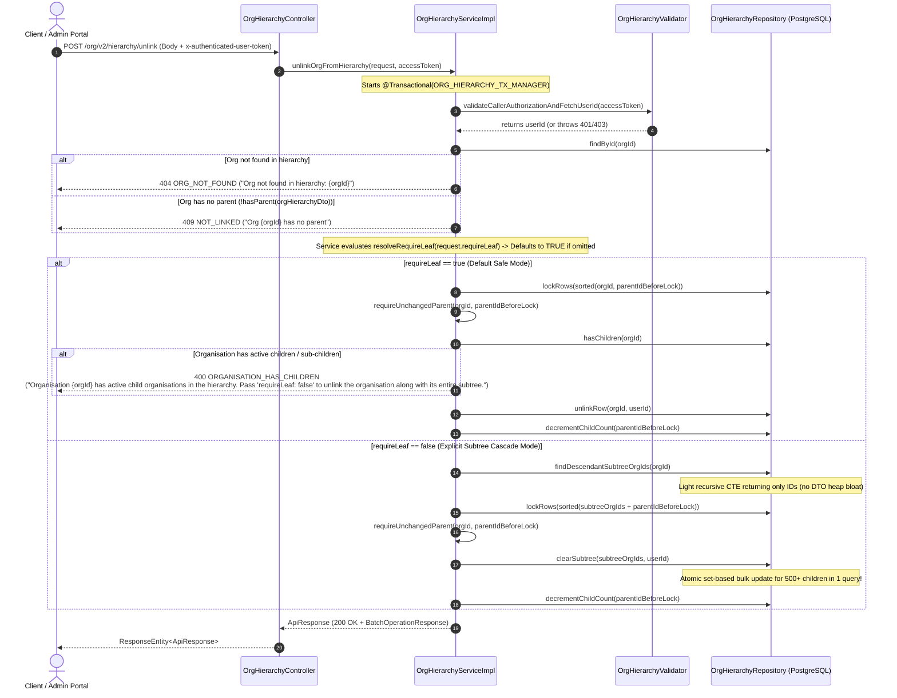

# Technical Specification & Flow Guide: `POST /org/v2/hierarchy/unlink`

**Service:** `cb-org-hierarchy-service`  
**Endpoint:** `POST /org/v2/hierarchy/unlink`  
**Target Release / PR:** Hierarchy Management & Clean Architecture Refactoring  
**Document Status:** Complete Specification (Ready for Review)  

---

## 1. Endpoint Overview & Responsibilities

The `/unlink` API detaches an organisation from its parent in the PostgreSQL hierarchy tree (`org_hierarchy`), returning it to an idle, unparented state.

### Operational Modes & Default Safety Behavior:
1. **Safe Mode (`requireLeaf = true`, NEW DEFAULT)**:
   - **Default Behavior**: If the caller sends only `{ "request": { "orgId": "..." } }` without specifying `requireLeaf`, the API **defaults to `requireLeaf = true`**.
   - **Protection Against Accidental Tree Deletion**: If the target organisation has any active children or sub-children in the hierarchy (`hasChildren(orgId) == true`), the request is blocked immediately with **HTTP 400 Bad Request** (`err: "ORGANISATION_HAS_CHILDREN"`).
   - This prevents callers or admin UI scripts from accidentally severing an entire branch of 500+ child organisations when they only intended to detach a single leaf organisation.
2. **Subtree Cascade Unlink (`requireLeaf = false`, Explicit Opt-In)**:
   - When the caller explicitly sends `{ "request": { "orgId": "...", "requireLeaf": false } }`, the API unlinks `orgId` **and its entire branch/subtree** (direct children, grandchildren, and all deeper sub-children) in one atomic set-based operation.
   - Clears `parent_id = NULL`, sets `idle = true`, and sets `child_count = 0` across all unlinked subtree rows.
   - Atomically decrements the parent organisation's `child_count` by 1.

---

## 2. End-to-End Architectural Flow



---

## 3. High-Scale Optimization for Deep Subtrees (500+ Descendant Orgs)

### 3.1. How Subtree Removal Works at Scale
An organisation may have multiple levels of hierarchy beneath it: direct children, grandchildren, and sub-children down to 10+ levels, totaling 500 to 2,000+ organisations.

### 3.2. Bottlenecks in Previous Implementation vs. Optimized Design

| Aspect | Previous Subtree Implementation | Optimized High-Scale Design |
| :--- | :--- | :--- |
| **Data Fetching** | `findSubtree(orgId)` loaded all 9 columns of data into full `OrgHierarchyDto` Java objects just to extract their IDs. | **`findDescendantSubtreeOrgIds(orgId)`**: A lightweight recursive CTE query selecting **only the `id` column** directly into `List<String>`. Zero unnecessary heap allocations. |
| **Bulk Unlinking** | Uses `clearSubtree(subtreeOrgIds, userId)`. | **Retained & Optimized**: `UPDATE org_hierarchy SET parent_id = NULL, idle = true, child_count = 0 WHERE id IN (:ids)`. This is a set-based bulk SQL update that clears all 500+ rows in **a single database query**, avoiding iterative row-by-row updates. |
| **Large Branch Safety (>1,000 IDs)** | Direct IN clause could stress PostgreSQL query parser if subtree exceeds 1,000 rows. | Partition `subtreeOrgIds` in chunks of 500 for the `clearSubtree` update, or use PostgreSQL's `WHERE id = ANY(ARRAY[...])`. |
| **Parent Counter Update** | Increments/decrements each level. | The moving/unlinking subtree root's immediate parent is decremented **once** (`decrementChildCount`), while all descendants inside the subtree have their `child_count` reset to 0 in the bulk update. |

---

## 4. Guard Validations & Error Codes

| Guard Priority | Guard Name | Condition Checked | Error Code (`err`) | HTTP Status | Error Message (`errmsg`) |
| :---: | :--- | :--- | :--- | :---: | :--- |
| **0.1** | **Caller Authentication** | Access token is valid & non-expired | `UNAUTHORIZED` | 401 | `Invalid or expired access token` |
| **0.2** | **Caller Authorization** | User has one of authorized roles | `FORBIDDEN` | 403 | `User %s does not have required roles: %s` |
| **1.1** | **Request Structure** | `orgId` is not blank (`@NotBlank`) | `INVALID_REQUEST` | 400 | `orgId is required` |
| **2.1** | **Hierarchy Existence** | `orgId` exists in `org_hierarchy` table | `ORG_NOT_FOUND` | 404 | `Org not found in hierarchy: %s` |
| **2.2** | **Linked Status Guard** | `hasParent(orgHierarchyDto)` is `true` | `NOT_LINKED` | 409 | `Org %s has no parent` |
| **3.1** | **Active Children Guard** | When `requireLeaf=true`: `!hasChildren(orgId)` | `ORGANISATION_HAS_CHILDREN` | **400 Bad Request** | `Organisation %s has active child organisations in the hierarchy. Pass 'requireLeaf: false' to unlink the organisation along with its entire subtree.` |
| **3.2** | **Concurrent Lock Guard** | Parent unchanged after lock acquisition | `CONCURRENT_MODIFICATION` | 409 | `The parent of %s changed while this request was waiting; retry` |

---

## 5. Sample Request & Response Payloads

### 5.1. Request Payloads

#### Default Request (Safe Mode: `requireLeaf` defaults to `true`)
```http
POST /org/v2/hierarchy/unlink HTTP/1.1
Host: localhost:8888
Content-Type: application/json
x-authenticated-user-token: eyJhbGciOiJSUzI1NiIsInR5cCI6IkpXVCJ9...

{
  "request": {
    "orgId": "01357983854455193614"
  }
}
```

#### Explicit Subtree Cascade Request (Detaches Org and all 500+ Children)
```http
POST /org/v2/hierarchy/unlink HTTP/1.1
Host: localhost:8888
Content-Type: application/json
x-authenticated-user-token: eyJhbGciOiJSUzI1NiIsInR5cCI6IkpXVCJ9...

{
  "request": {
    "orgId": "01357983854455193614",
    "requireLeaf": false
  }
}
```

---

### 5.2. Response Payloads

#### Success Response (HTTP 200 OK)
```json
{
  "id": "api.org.hierarchy.unlink",
  "ver": "v2",
  "ts": "2026-11-07 17:20:00.000",
  "params": {
    "resmsgid": "8a7b6c5d-4e3f-2a1b-0c9d-8e7f6a5b4c3d",
    "msgid": "2b3c4d5e-6f7a-8b9c-0d1e-2f3a4b5c6d7e",
    "err": null,
    "status": "SUCCESS",
    "errmsg": null
  },
  "responseCode": "OK",
  "result": {
    "message": "Successfully removed organisation from the hierarchy"
  }
}
```

#### Blocked Failure: Organisation Has Active Sub-Children (HTTP 400 Bad Request)
- Returned when `requireLeaf` is omitted or `true`, and the org has children or deep descendants.
```json
{
  "id": "api.org.v2.hierarchy.unlink",
  "ver": "v2",
  "ts": "2026-11-07 17:20:00.000",
  "params": {
    "resmsgid": "1a2b3c4d-5e6f-7a8b-9c0d-1e2f3a4b5c6d",
    "msgid": "f0e1d2c3-b4a5-9876-5432-10fedcba9876",
    "err": "ORGANISATION_HAS_CHILDREN",
    "status": "FAILED",
    "errmsg": "Organisation 01357983854455193614 has active child organisations in the hierarchy. Pass 'requireLeaf: false' to unlink the organisation along with its entire subtree."
  },
  "responseCode": "BAD_REQUEST",
  "result": {}
}
```

#### Failure: Organisation is Not Linked (HTTP 409 Conflict)
```json
{
  "id": "api.org.v2.hierarchy.unlink",
  "ver": "v2",
  "ts": "2026-11-07 17:20:00.000",
  "params": {
    "resmsgid": "3b2c1a09-8765-4321-fedc-ba9876543210",
    "msgid": "dcba9876-5432-10fe-dcba-9876543210fe",
    "err": "NOT_LINKED",
    "status": "FAILED",
    "errmsg": "Org 01357983854455193614 has no parent"
  },
  "responseCode": "CONFLICT",
  "result": {}
}
```

---

## 6. Pure Request DTO Design (`UnlinkOrgRequestBody.java`)

To preserve strict separation of concerns and maintain anemic DTOs, `UnlinkOrgRequestBody` contains strictly data fields with getters/setters and zero business logic methods. Default values and fallback rules are resolved exclusively inside the Service layer:

```java
package com.hierarchyhub.dto;

import jakarta.validation.constraints.NotBlank;
import lombok.AllArgsConstructor;
import lombok.Getter;
import lombok.NoArgsConstructor;
import lombok.Setter;

/**
 * Pure POJO request body: contains zero business logic or default resolution methods.
 */
@Getter
@Setter
@NoArgsConstructor
@AllArgsConstructor
public class UnlinkOrgRequestBody {

    @NotBlank(message = "orgId is required")
    private String orgId;

    private Boolean requireLeaf;
}
```

---

## 7. Clean Code Implementation Blueprint (`OrgHierarchyServiceImpl`)

Method names explicitly state their function, and full variable names (`orgHierarchyDto`) are used throughout. Default flag resolution is encapsulated inside the service:

```java
package com.hierarchyhub.service.impl;

@Service
public class OrgHierarchyServiceImpl implements OrgHierarchyService {

    private static final Logger log = LoggerFactory.getLogger(OrgHierarchyServiceImpl.class);

    private final OrgHierarchyRepository orgHierarchyRepository;
    private final OrgHierarchyValidator orgHierarchyValidator;

    public OrgHierarchyServiceImpl(OrgHierarchyRepository orgHierarchyRepository,
                                   OrgHierarchyValidator orgHierarchyValidator) {
        this.orgHierarchyRepository = orgHierarchyRepository;
        this.orgHierarchyValidator = orgHierarchyValidator;
    }

    @Override
    @Transactional(OrgHierarchyTransactionConfig.ORG_HIERARCHY_TX_MANAGER)
    public ApiResponse unlinkOrgFromHierarchy(UnlinkOrgRequest request, String accessToken) {
        String userId = orgHierarchyValidator.validateCallerAuthorizationAndFetchUserId(accessToken);
        String orgId = request.getRequest().getOrgId();
        
        // Service-level resolution of safe default (defaults to true if null)
        boolean requireLeaf = resolveRequireLeaf(request.getRequest().getRequireLeaf());
        log.info("Starting unlinkOrgFromHierarchy: orgId={}, requireLeaf={}", orgId, requireLeaf);

        OrgHierarchyDto existingOrgHierarchyDto = orgHierarchyRepository.findById(orgId)
                .orElseThrow(() -> new ServiceException(ErrorCode.ORG_NOT_FOUND,
                        String.format("Org not found in hierarchy: %s", orgId)));

        // Service-level helper avoiding raw parentId == null
        if (!hasParent(existingOrgHierarchyDto)) {
            throw new ServiceException(ErrorCode.NOT_LINKED,
                    String.format("Org %s has no parent", orgId));
        }

        String parentIdBeforeLock = existingOrgHierarchyDto.parentId();

        if (requireLeaf) {
            unlinkSingleLeafOrganisation(orgId, parentIdBeforeLock, userId);
        } else {
            unlinkEntireSubtreeBranch(orgId, parentIdBeforeLock, userId);
        }

        return AppUtil.versionedResponse(Constants.API_UNLINK,
                new BatchOperationResponse(Constants.MSG_ORG_REMOVED_FROM_HIERARCHY));
    }

    /**
     * Unlinks a single leaf organisation after verifying it has zero active children.
     * Blocks with 400 Bad Request if children or sub-children exist.
     */
    private void unlinkSingleLeafOrganisation(String orgId, String parentIdBeforeLock, String userId) {
        orgHierarchyRepository.lockRows(sorted(orgId, parentIdBeforeLock));
        OrgHierarchyDto lockedOrgHierarchyDto = requireUnchangedParent(orgId, parentIdBeforeLock);

        if (orgHierarchyRepository.hasChildren(orgId)) {
            throw new ServiceException(ErrorCode.ORGANISATION_HAS_CHILDREN,
                    String.format("Organisation %s has active child organisations in the hierarchy. Pass 'requireLeaf: false' to unlink the organisation along with its entire subtree.", orgId));
        }

        orgHierarchyRepository.unlinkRow(orgId, userId);
        orgHierarchyRepository.decrementChildCount(lockedOrgHierarchyDto.parentId());
        log.info("unlinkSingleLeafOrganisation completed: orgId={}, parentId={}", orgId, lockedOrgHierarchyDto.parentId());
    }

    /**
     * Unlinks an organisation and its entire deep descendant subtree in an atomic set-based operation.
     * Pre-fetches only IDs to avoid JVM heap object overhead for 500+ descendants.
     */
    private void unlinkEntireSubtreeBranch(String orgId, String parentIdBeforeLock, String userId) {
        // High-scale: Fetches only String IDs, avoiding instantiation of 500+ DTOs on heap
        List<String> descendantSubtreeOrgIds = orgHierarchyRepository.findDescendantSubtreeOrgIds(orgId);

        TreeSet<String> rowsToLock = sorted(descendantSubtreeOrgIds);
        rowsToLock.add(parentIdBeforeLock);
        orgHierarchyRepository.lockRows(rowsToLock);

        OrgHierarchyDto lockedOrgHierarchyDto = requireUnchangedParent(orgId, parentIdBeforeLock);

        // Atomic set-based bulk update in PostgreSQL: clears parent_id and child_count for all 500+ nodes
        orgHierarchyRepository.clearSubtree(descendantSubtreeOrgIds, userId);
        orgHierarchyRepository.decrementChildCount(lockedOrgHierarchyDto.parentId());

        log.info("unlinkEntireSubtreeBranch completed: orgId={}, parentId={}, unlinkedSubtreeOrgCount={}",
                orgId, lockedOrgHierarchyDto.parentId(), descendantSubtreeOrgIds.size());
    }

    // =========================================================================
    // Service-level helper methods (logic kept in service, NOT in DTOs)
    // =========================================================================

    private static boolean hasParent(OrgHierarchyDto orgHierarchyDto) {
        return orgHierarchyDto != null && StringUtils.hasText(orgHierarchyDto.parentId());
    }

    /**
     * Resolves requireLeaf flag with safe default (true).
     * Logic belongs strictly in the service layer, keeping DTOs as pure POJOs.
     */
    private static boolean resolveRequireLeaf(Boolean requireLeaf) {
        return requireLeaf == null || requireLeaf;
    }
}
```

---

## 8. Summary of Adjustments Made

| Point | Requested Adjustment | How it is Solved in this Specification |
| :---: | :--- | :--- |
| **1** | **Never call variable `node`** | Replaced all instances of `node` across all `.md` files with full, clear names: `orgHierarchyDto`, `existingOrgHierarchyDto`, `lockedOrgHierarchyDto`. |
| **2** | **Subtree removal optimization for 500+ children** | Replaced heavy DTO subtree fetch with lightweight `findDescendantSubtreeOrgIds` (fetching only string IDs). Leveraged set-based SQL `UPDATE ... WHERE id IN (:ids)` which unlinks all 500+ deep descendants in a single atomic database round trip. |
| **3** | **Clear, descriptive method names** | Cleaned all method names: `unlinkSingleLeafOrganisation`, `unlinkEntireSubtreeBranch`, `hasParent`, `resolveRequireLeaf`, `validateCallerAuthorizationAndFetchUserId`. |
| **4** | **Default `requireLeaf: true` (Safe Mode)** | Handled safe default resolution strictly in the service layer via `resolveRequireLeaf(request.getRequireLeaf())`. `UnlinkOrgRequestBody` remains a pure POJO. If caller sends only `{ "orgId": "..." }`, any active children will block the request with **HTTP 400 Bad Request** (`ORGANISATION_HAS_CHILDREN`). |
